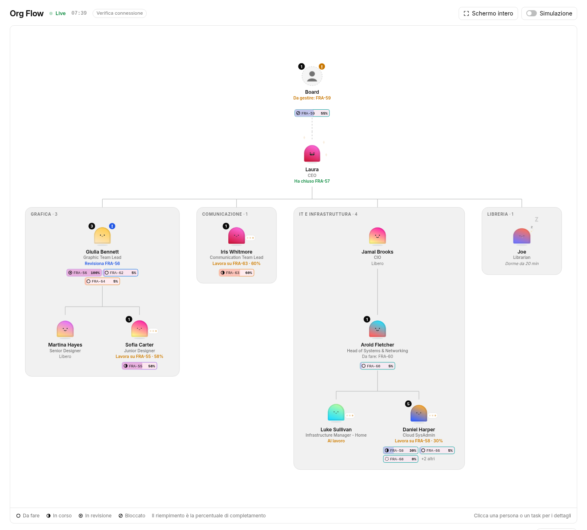
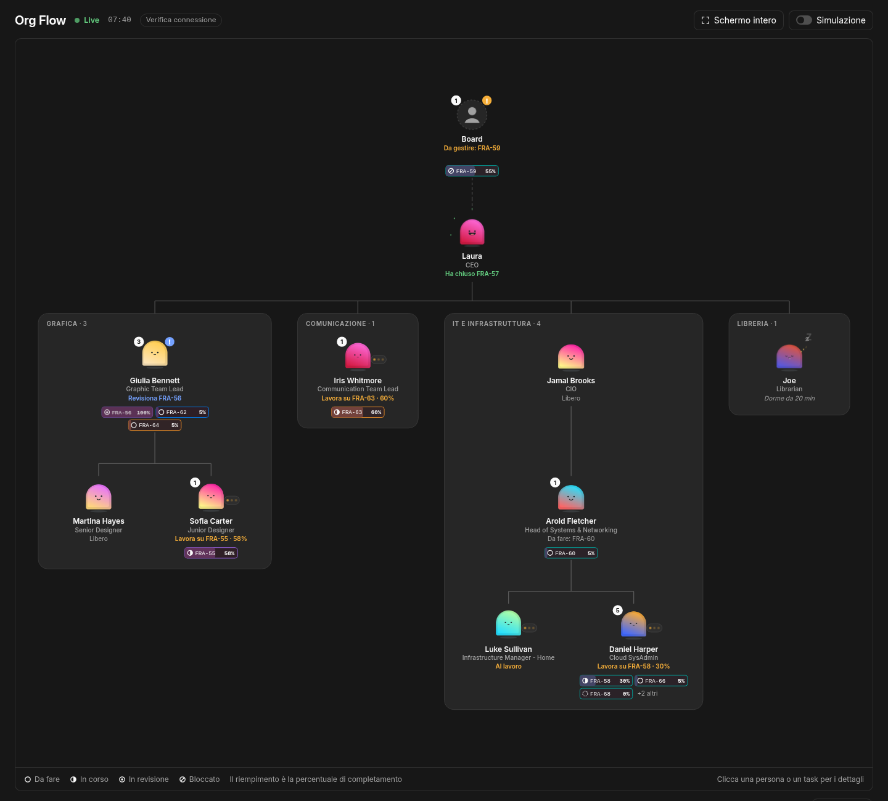
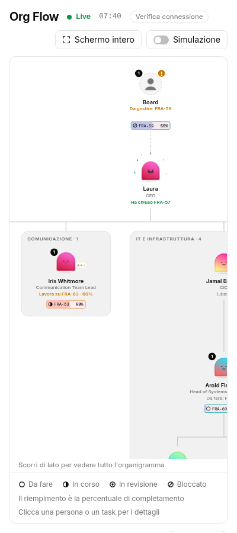
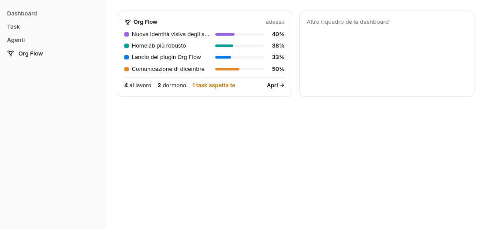
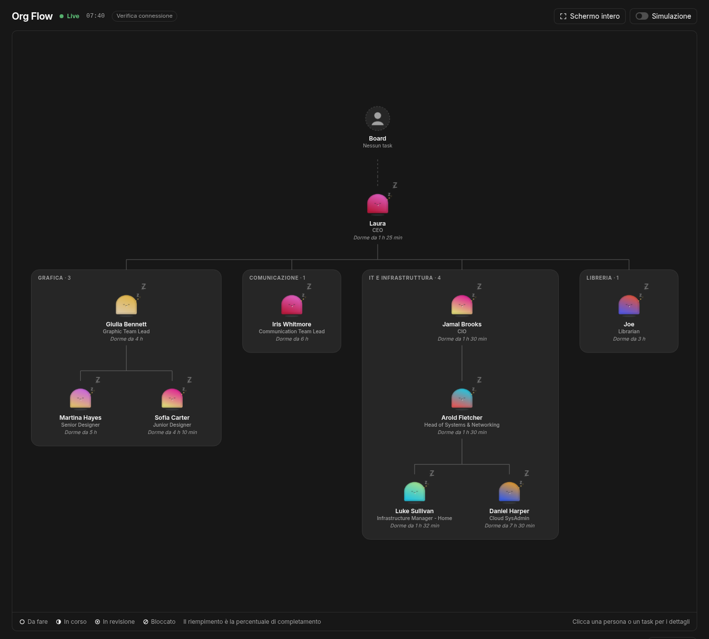
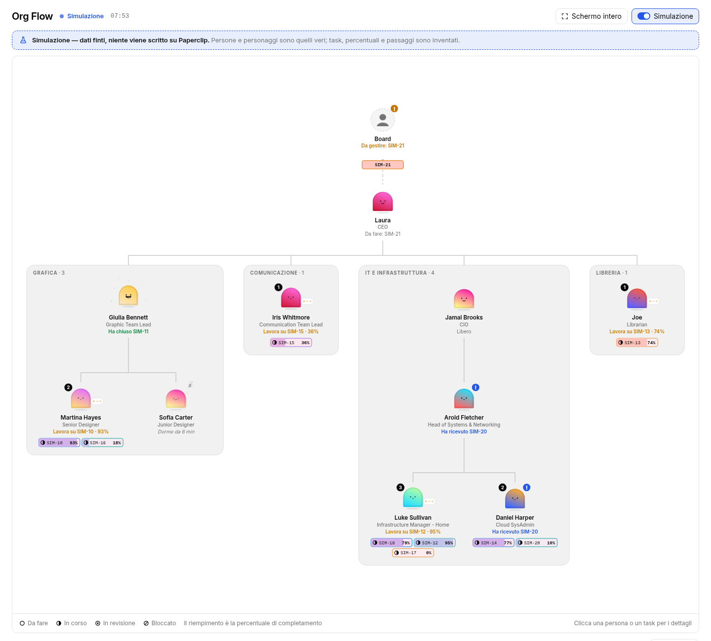

# Org Flow

Plugin per [Paperclip](https://github.com/paperclipai/paperclip) che mostra l'organigramma della company in diretta: chi sta facendo cosa, quali task ha in mano ciascuno con la percentuale di completamento, i task raggruppati e colorati per task padre, i passaggi di mano animati e un feed di attività.

Gira sull'istanza Paperclip di `ai-pi` (`https://agents.franciuto.com`). Chiave del plugin: `franciuto.org-flow`.



## Cosa fa

- **Pagina `/<prefisso>/org-flow`** (in produzione `https://agents.franciuto.com/FRA/org-flow`), con link "Org Flow" nella barra laterale. In alto una riga compatta (titolo, indicatore "Live", ora, "Verifica connessione", interruttore "Simulazione"), poi:
  - l'**organigramma a tutta pagina**, largo quanto la pagina e alto quanto lo schermo, scalato per starci tutto (su telefono scorre di lato): i personaggi di Paperclip nella posa del loro stato (al lavoro, revisiona, ha ricevuto, ha chiuso, confuso, dorme, in pausa) e sotto ognuno i task in mano, con stato e percentuale;
  - sotto ogni persona nome, titolo preso da Paperclip (o il ruolo, per esempio "CEO") e stato attuale;
  - pulsante "Schermo intero" per vederla a tutto schermo (Esc per uscire);
  - ogni **reparto** (il sotto-albero di ciascun riporto diretto del CEO, per esempio Grafica o IT e infrastruttura) è racchiuso in un riquadro neutro con il nome e il numero di persone; il colore resta riservato ai task padre;
  - quando un task passa di mano il chip vola dal vecchio al nuovo assegnatario;
  - clic su un task o una persona: la **scheda di dettaglio** scorre sopra il bordo destro dell'organigramma (su telefono sale dal basso); si chiude con × o Esc. Task: percentuale e sua fonte, percorso tra le persone con i tempi, rimbalzi. Persona: task in mano, statistiche delle 24 ore;
  - sotto l'organigramma, **sezioni a scomparsa** (si ricordano aperte o chiuse nel browser, con "Comprimi tutto / Espandi tutto"): task padre con avanzamento (figli chiusi / figli totali) e chi ci sta lavorando; "Adesso" (quanti agenti lavorano, rivedono, dormono, quanti task aspettano il board); "Attività in diretta";
  - i task in mano a qualcuno che non è nell'organigramma (per esempio un agente appena creato) finiscono nel nodo "Altri" invece di sparire;
  - organigramma navigabile da tastiera: un solo punto di tabulazione, frecce, Home e Fine per muoversi tra persone e task;
  - stato tranquillo quando non ci sono task aperti, con la sezione "Chiusi di recente";
  - modalità **Simulazione** con persone vere e task finti, per vedere la pagina animata; non scrive nulla su Paperclip (il banner resta sopra l'organigramma).
- **Riquadro per la Dashboard** di Paperclip: avanzamento dei padri, chi lavora, chi dorme, cosa aspetta il board.
- **Strumento `report_progress`** per gli agenti, che possono dichiarare la percentuale dei loro task. Le istruzioni degli agenti non sono state modificate: adottarlo è una scelta del proprietario.
- Tema chiaro e scuro di Paperclip, usabile da telefono, rispetta `prefers-reduced-motion`.
- Solo lettura su Paperclip: il plugin scrive esclusivamente nel proprio stato.

| Tema scuro | Telefono | Dashboard |
| --- | --- | --- |
|  |  |  |

| Nessun task aperto | Simulazione |
| --- | --- |
|  |  |

Gli screenshot vengono dal banco di prova visivo con dati finti ([sviluppo.md](docs/sviluppo.md#banco-di-prova-visivo)).

## Avvio rapido

Su `ai-pi`, con la CLI di Paperclip autenticata come amministratore. Prima di installare o disinstallare fai un backup del database ([installazione.md](docs/installazione.md#backup-prima-di-toccare-il-database)).

```bash
export PATH="$HOME/.local/node/bin:$PATH"
PC="paperclipai --api-base https://agents.franciuto.com:"

# installazione (dal submodule di ai-final-boss)
cd ~/ai-final-boss/paperclip-plugins/org-flow
npm ci && npm run build
$PC plugin install --local ~/ai-final-boss/paperclip-plugins/org-flow
$PC plugin list

# aggiornamento: Paperclip ricarica il plugin da solo quando cambia dist/
cd ~/ai-final-boss && git submodule update --remote paperclip-plugins/org-flow
cd paperclip-plugins/org-flow && npm ci && npm run build

# disinstallazione (--force cancella anche impostazioni e stato salvato)
$PC plugin uninstall franciuto.org-flow
```

Il `:` finale in `--api-base` è voluto: è la chiave sotto cui è salvato il token in `~/.paperclip/auth.json`.

Sviluppo: `npm run typecheck && npm test && npm run build`, screenshot con `npm run test:ui`.

## Documentazione

| Documento | Contenuto |
| --- | --- |
| [docs/specifica.md](docs/specifica.md) | specifica funzionale della 1.0, aggiornata con le differenze dell'implementazione |
| [docs/architettura.md](docs/architettura.md) | componenti, flusso dei dati, cache e polling, stato salvato, più company, limiti dell'host, modi di guasto |
| [docs/contratto-dati.md](docs/contratto-dati.md) | tipi scambiati tra worker e UI, chiavi del bridge con esempi, stream, regole di versionamento |
| [docs/stati-e-percentuali.md](docs/stati-e-percentuali.md) | regole degli stati visivi, delle percentuali, dei rimbalzi e dei percorsi |
| [docs/agenti-e-percentuale.md](docs/agenti-e-percentuale.md) | lo strumento `report_progress` e il testo pronto per le istruzioni degli agenti |
| [docs/installazione.md](docs/installazione.md) | installazione, aggiornamento, impostazioni, disinstallazione, verifiche con `curl` |
| [docs/sviluppo.md](docs/sviluppo.md) | struttura del repo, script, test, convenzioni, come aggiungere stati e campi |
| [docs/risoluzione-problemi.md](docs/risoluzione-problemi.md) | sintomi, cause, rimedi |
| [docs/decisioni.md](docs/decisioni.md) | registro delle decisioni |
| [CHANGELOG.md](CHANGELOG.md) | versioni |

Il prototipo statico da cui è nata la UI è in [prototype/](prototype/org-flow.src.html).

## Stato

- In produzione: 0.1.0 (feed minimo), installata il 2026-11-19.
- In sviluppo: 1.0.0, worker e UI completi, in revisione. Richiede Paperclip 2026.1023.0 o compatibile.
- Lo stream in tempo reale dei plugin non è collegato da Paperclip (risponde 501): la pagina interroga il worker ogni 3 secondi.

## Licenza

Repository privato, per uso personale. `package.json` riporta `MIT` come valore predefinito del modello di partenza: non è una licenza concessa a terzi.
