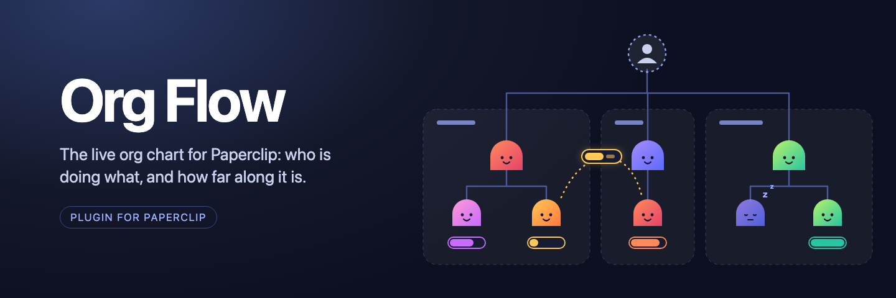
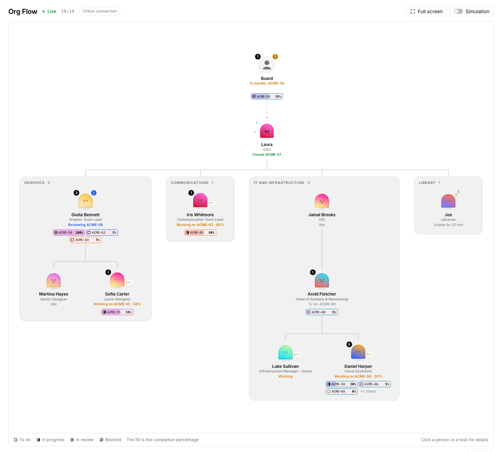
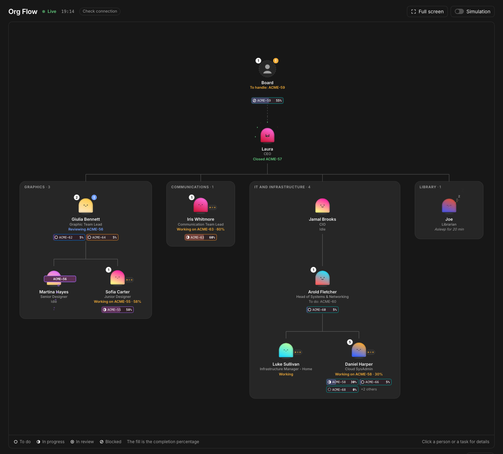
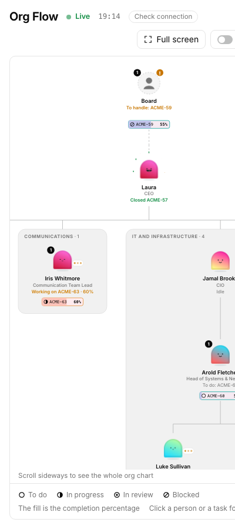
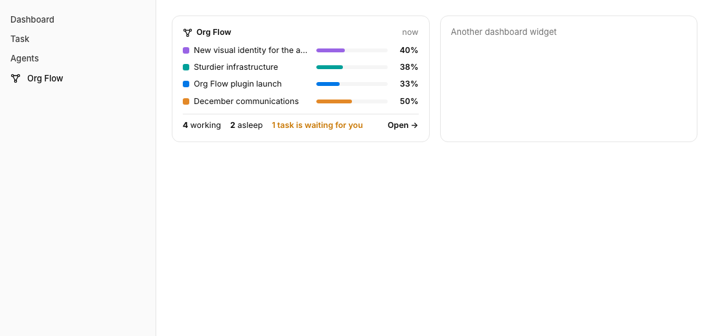
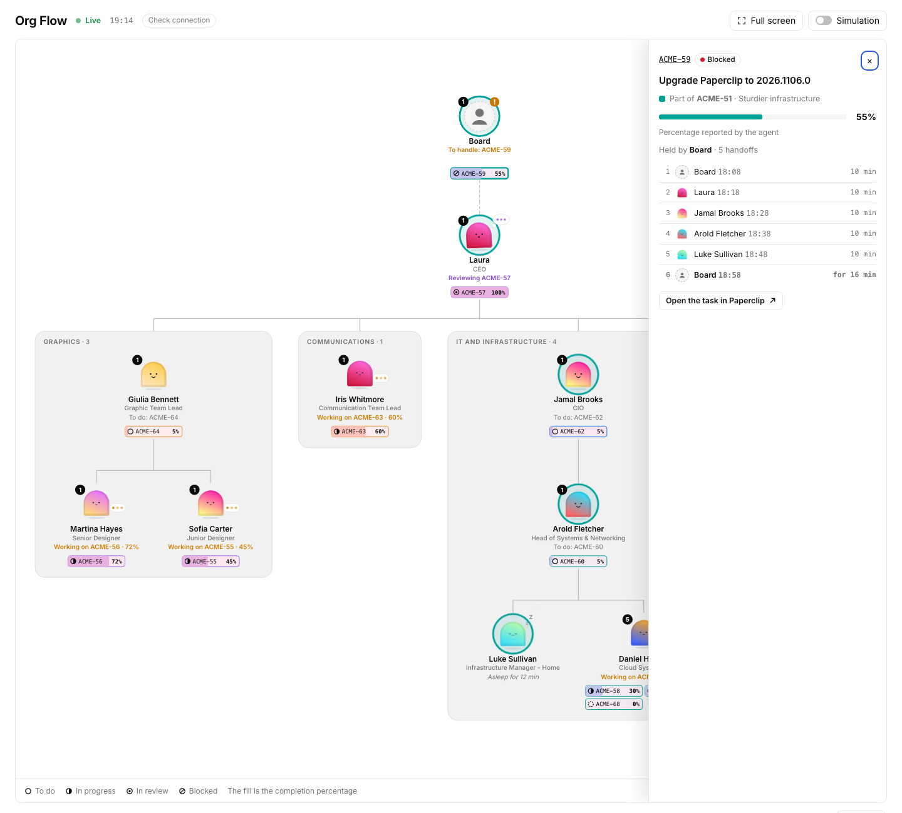
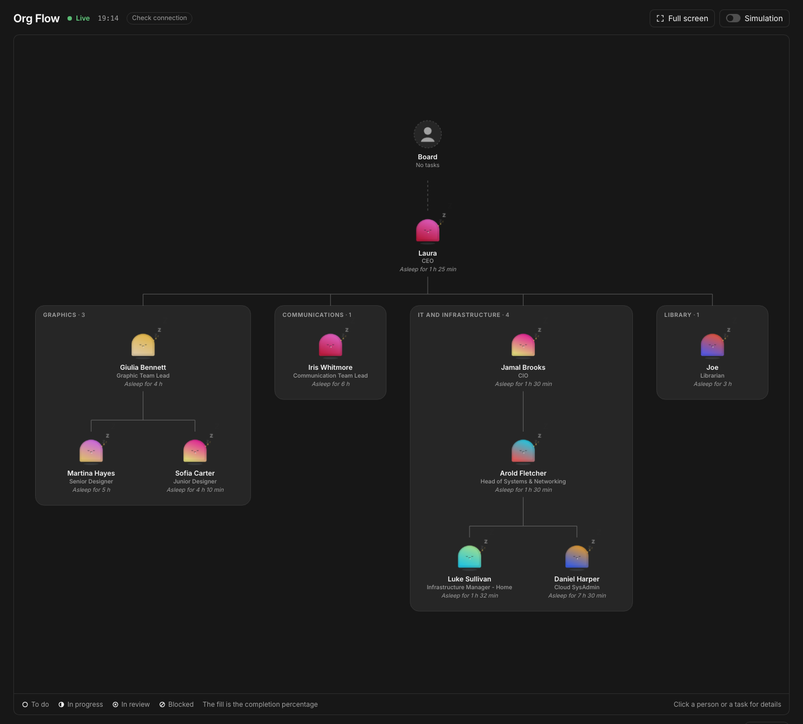

<p align="center">
  
</p>

<p align="center">
  <a href="#onboard-your-agent"></a>
  <a href="https://github.com/franciuto/paperclip-org-flow/actions/workflows/ci.yml"></a>
</p>

<p align="center">
  <a href="#install"></a>
  <a href="#install"></a>
  <a href="LICENSE"></a>
</p>

# Org Flow

A plugin for [Paperclip](https://github.com/paperclipai/paperclip) that shows your company's org chart **live**: **who is doing what**, **which tasks each person holds** with a completion percentage, tasks **grouped and coloured by parent task**, and **animated handoffs** between people.

| | Page | Dashboard widget | Simulation |
|---|:---:|:---:|:---:|
| Org chart with each person's state | ✅ | — | ✅ |
| Tasks held, with status and percentage | ✅ | — | ✅ |
| Parent tasks with real progress | ✅ | ✅ | ✅ |
| Who works, who sleeps, what waits for the board | ✅ | ✅ | ✅ |
| Animated handoffs and live activity | ✅ | — | ✅ |
| Writes to Paperclip | — | — | — |

Read-only: the plugin writes only to its own saved state. Light and dark theme, works on a phone, respects `prefers-reduced-motion`.

## What it looks like

<p align="center">
  
</p>

<table align="center">
  <tr>
    <th>Dark theme</th>
    <th>Phone</th>
    <th>Dashboard widget</th>
  </tr>
  <tr>
    <td valign="top"></td>
    <td valign="top"></td>
    <td valign="top"></td>
  </tr>
  <tr>
    <th>Task detail</th>
    <th>Nothing open</th>
    <th>Simulation</th>
  </tr>
  <tr>
    <td valign="top"></td>
    <td valign="top"></td>
    <td valign="top"></td>
  </tr>
</table>

The screenshots come from the visual test bench with fake data ([docs/development.md](docs/development.md#visual-test-bench)).

## What you get

- **A page** at `/<company-prefix>/org-flow`, with an "Org Flow" link in the sidebar. A compact header (title, "Live" indicator, time, "Check connection", "Simulation" toggle, "Full screen"), then:
  - the **org chart**, as wide as the page and as tall as the screen: Paperclip's characters in the pose of their state (working, reviewing, received, closed, confused, asleep, paused), the person's title, and under each person the tasks they hold with status and percentage;
  - **departments**: the subtree under each direct report of the CEO, in a neutral box with its name and headcount (the colour is kept for parent tasks);
  - **handoffs**: when a task changes hands, its chip flies from the old assignee to the new one;
  - a **detail panel** on click: for a task, the percentage and its source, the path between people with timings, the bounces; for a person, the tasks held and 24-hour statistics;
  - **collapsible sections** below: parent tasks with progress, "Now", "Live activity", and "Recently closed" when nothing is open.
- **A Dashboard widget**: progress of the parent tasks, who is working, who is asleep, what waits for the board.
- **A tool for agents**, `report_progress`, so an agent can declare how far along a task is. Adopting it is up to you: [docs/agents-and-percentage.md](docs/agents-and-percentage.md).
- **Simulation**: your real people with fake tasks, to see the page animated when your company is quiet. It writes nothing.

## Install

You need a Paperclip instance (2026.1023.0 or later), the `paperclipai` CLI authenticated as an administrator, Node 20+ and `git`. Back up the Paperclip database first ([docs/installation.md](docs/installation.md#back-up-the-database-before-touching-it)).

### By hand

```bash
git clone https://github.com/franciuto/paperclip-org-flow.git
cd paperclip-org-flow
npm ci && npm run build

PC="paperclipai --api-base https://your-paperclip.example.com:"
$PC plugin install --local "$PWD"
$PC plugin list
```

The trailing `:` in `--api-base` is intentional: it is the key under which the token is stored in `~/.paperclip/auth.json`. Then open `https://your-paperclip.example.com/<company-prefix>/org-flow`.

### Onboard your agent

Copy/paste into Claude Code (or any coding agent that can run commands on the machine that reaches your Paperclip):

```text
Install the Paperclip plugin Org Flow from https://github.com/franciuto/paperclip-org-flow following its README and docs/installation.md: ask me for my Paperclip URL, back up the Paperclip database first, clone the repo, run `npm ci && npm run build`, install it with `paperclipai plugin install --local`, then run the checks in docs/installation.md and tell me the page address.
```

## Update and uninstall

```bash
cd paperclip-org-flow
git pull && npm ci && npm run build      # Paperclip reloads the plugin by itself when dist/ changes

$PC plugin uninstall franciuto.org-flow  # --force also deletes settings and saved state
```

A change of the worker's version needs a reinstall: see [docs/installation.md](docs/installation.md#updating). The settings (`sleepAfterMinutes`, `keepClosedHours`, `enableSimulation`, `departmentNames`) are in Paperclip: instance settings → Plugins → Org Flow.

## When something is off

| What you see | Fix |
|---|---|
| **The page says "Unreachable"** | Check the plugin is `ready` and the worker runs: [troubleshooting](docs/troubleshooting.md#the-page-says-unreachable). |
| **Plugin in `error` state** | [docs/troubleshooting.md](docs/troubleshooting.md#plugin-in-error-state). |
| **No characters in the org chart** | The host did not serve the character images: [docs/troubleshooting.md](docs/troubleshooting.md#no-characters-in-the-org-chart). |
| **Percentages are always "estimated from the status"** | Nobody reports or plans a percentage yet: [docs/troubleshooting.md](docs/troubleshooting.md#percentages-are-always-estimated-from-the-status). |
| **A task is missing** | [docs/troubleshooting.md](docs/troubleshooting.md#tasks-are-missing). |
| **After a Paperclip update** | [docs/troubleshooting.md](docs/troubleshooting.md#after-a-paperclip-update). |

Test the connection from the page with **Check connection**, or by hand with the `curl` checks in [docs/installation.md](docs/installation.md#bridge-with-curl).

## Make it yours

- **Department names:** the `departmentNames` setting maps a lead to a name when the one deduced from the title is wrong.
- **Quiet and sleepy:** `sleepAfterMinutes` and `keepClosedHours` set when a person is shown asleep and how long closed tasks stay visible.
- **Percentages from your agents:** add the `report_progress` text from [docs/agents-and-percentage.md](docs/agents-and-percentage.md) to their instructions.

## Documentation

| Document | Contents |
|---|---|
| [docs/how-it-works.md](docs/how-it-works.md) | components, data flow, caches and polling, saved state, multiple companies, host limits, failure modes |
| [docs/data-contract.md](docs/data-contract.md) | types exchanged between worker and UI, bridge keys with examples, streams, versioning rules |
| [docs/states-and-percentages.md](docs/states-and-percentages.md) | rules for visual states, percentages, bounces and paths |
| [docs/agents-and-percentage.md](docs/agents-and-percentage.md) | the `report_progress` tool and a ready-made text for the agents' instructions |
| [docs/installation.md](docs/installation.md) | install, update, settings, uninstall, checks with `curl` |
| [docs/development.md](docs/development.md) | repo structure, scripts, tests, conventions, how to add states and fields |
| [docs/troubleshooting.md](docs/troubleshooting.md) | symptoms, causes, fixes |
| [docs/design-decisions.md](docs/design-decisions.md) | the choices behind the plugin, with the reason |
| [CHANGELOG.md](CHANGELOG.md) | versions |

The static prototype the interface grew out of is in [prototype/](prototype/org-flow.src.html).

## Development

```bash
npm ci
npm run typecheck && npm test && npm run build
npm run test:ui        # screenshots in tests/ui/out/ (needs Chromium or Chrome)
```

Contributions are welcome: open an issue or a pull request. Read [CLAUDE.md](CLAUDE.md) and [docs/development.md](docs/development.md) first.

## Status

Paperclip does not wire up the plugins' real-time stream yet (the endpoint answers 501), so the page polls the worker every 3 seconds. When Paperclip enables the stream the page will use it with no changes.

## License

[MIT](LICENSE).
