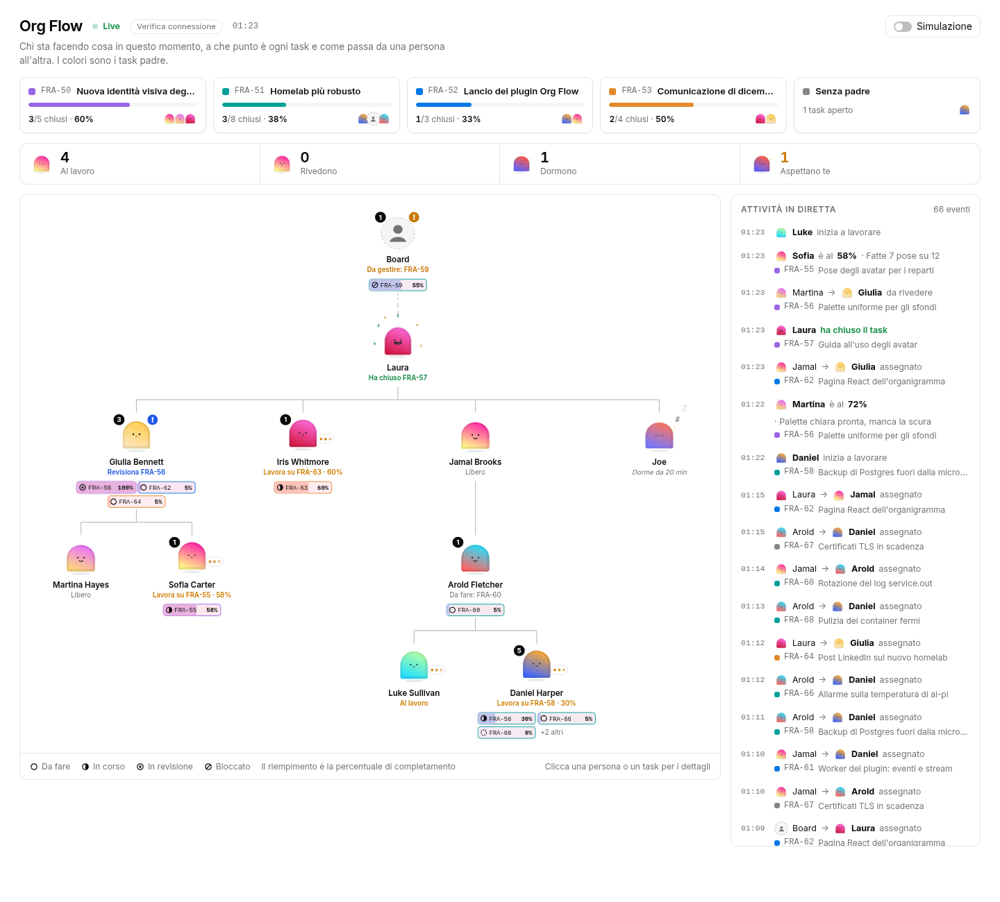

# Gli agenti e la percentuale: `report_progress`

Paperclip non ha un campo "percentuale" sui task. Org Flow la ricava da più fonti ([stati-e-percentuali.md](stati-e-percentuali.md#percentuale-di-un-task)); la più precisa è quella che l'agente dichiara da solo con lo strumento `report_progress`.

**Stato attuale: le istruzioni degli agenti NON sono state modificate.** Lo strumento è registrato e funziona, ma nessun agente sa di doverlo usare. Aggiungerlo alle istruzioni (AGENTS.md o equivalente) è una decisione del proprietario: costa qualche chiamata in più per run e cambia leggermente il comportamento degli agenti. Finché non lo si fa, le percentuali vengono dalla checklist del piano o dalla stima dallo stato.

## Cosa fa

1. L'agente chiama `report_progress` durante un run, su un task che ha in carico.
2. Il worker controlla i parametri e i permessi.
3. Salva il valore nello stato del plugin (chiave `reported-progress` della company e chiave `progress` del task).
4. Pubblica un record `progress` nel feed e ricalcola lo snapshot.
5. Nella pagina di Org Flow il chip del task mostra la nuova percentuale, il feed mostra "Sofia è al 58% · nota", la scheda del task dice "Percentuale riportata dall'agente" con la nota.

Non cambia nulla in Paperclip: né lo stato del task, né l'assegnatario, né commenti. Per chiudere un task si usa il normale cambio di stato; non serve riportare 100%.

## Registrazione

- Dichiarato nel manifest (`tools`) e registrato nel worker con `ctx.tools.register` (capability `agent.tools.register`).
- Paperclip lo espone con il nome del plugin come prefisso: `franciuto.org-flow:report_progress`. Il nome esatto che vede l'agente dipende dall'adapter.
- Nome visualizzato: "Riporta avanzamento".
- Verifica che sia registrato:

  ```bash
  export PATH="$HOME/.local/node/bin:$PATH"
  paperclipai plugin tools --api-base "https://agents.franciuto.com:"
  ```

La descrizione che l'agente legge (in `src/worker/tool.ts`) dice già quando usarlo: a ogni passo significativo, indicativamente ogni 20–25%, o quando la stima cambia, con una nota breve; solo per i task propri o dei sottoposti; non serve riportare 100%.

## Parametri

| Parametro | Tipo | Obbligatorio | Regole |
| --- | --- | --- | --- |
| `issue` | string | sì | identificatore (`FRA-62`, maiuscole o minuscole) oppure UUID del task. Spazi iniziali e finali tolti |
| `percent` | integer | sì | 0–100. Accetta anche numeri come testo (`"40"`, `"40%"`) e decimali, che arrotonda |
| `note` | string | no | massimo 200 caratteri dopo aver tolto gli spazi; vuota = nessuna nota |

Esempio di chiamata:

```json
{ "issue": "FRA-62", "percent": 60, "note": "Componenti fatti, manca il tema scuro" }
```

## Validazione ed errori

Gli errori tornano all'agente come testo in italiano, pensato per fargli correggere la chiamata da solo.

| Caso | Messaggio (sintesi) |
| --- | --- |
| parametri mancanti o non oggetto | "Parametri mancanti: servono issue (es. FRA-62) e percent (0-100)." |
| `issue` vuoto | "Parametro issue mancante: …" |
| `percent` non numerico | "Parametro percent non valido: deve essere un numero da 0 a 100." |
| `percent` < 0 o > 100 | "Parametro percent fuori intervallo (…)" |
| `note` non testo | "Parametro note non valido: deve essere un testo." |
| `note` più lunga di 200 caratteri | "La nota è troppo lunga (N caratteri): massimo 200." |
| run senza company o agente | "Contesto del run incompleto: …" |
| task non trovato nella company | "Task "FRA-99" non trovato in questa company. …" |
| task chiuso (`done` o `cancelled`) | "Il task FRA-62 è già chiuso (done): non serve riportare l'avanzamento." |
| task di un altro | "Puoi riportare l'avanzamento solo sui task assegnati a te o ai tuoi sottoposti: FRA-62 è assegnato a <nome>." (o "il board", o "nessuno") |

Permessi: il task deve essere assegnato all'agente che chiama o a un agente che gli riporta, direttamente o lungo la catena `reportsTo` (un responsabile può riportare per un sottoposto). I cicli nella catena non bloccano il controllo. I task assegnati a un utente umano o non assegnati sono rifiutati.

Ricerca del task: prima `ctx.issues.get` con il valore passato (Paperclip risolve sia l'id sia l'identificatore); se non lo trova e il valore ha la forma `ABC-123`, cerca l'identificatore tra i task già noti al worker.

Risposta in caso di successo:

```json
{
  "content": "Avanzamento registrato: FRA-62 al 60%. Nota: \"Componenti fatti, manca il tema scuro\". Il board lo vede ora in Org Flow.",
  "data": { "issueId": "e2a0…", "identifier": "FRA-62", "percent": 60, "note": "Componenti fatti, manca il tema scuro", "reportedAt": "2026-11-19T00:50:41.000Z" }
}
```

## Quanto dura il valore

- Vale finché l'agente non ne riporta un altro.
- Viene azzerato se il task viene riaperto o passa a una persona diversa da chi l'ha riportato. Torna quindi alla checklist o alla stima, e il nuovo assegnatario può riportare il suo.
- Resta se cambia solo lo stato (es. `in_progress` → `in_review`).
- Quando il task è `done` la percentuale è comunque 100.
- I valori più vecchi di 30 giorni vengono scartati.

## Come appare

- **Chip nell'organigramma**: riempimento e numero aggiornati appena arriva l'evento (polling ogni 3 s).
- **Feed "Attività in diretta"**: riga con personaggio dell'agente in posa `working`, "è al **60%**" e la nota (tagliata a 60 caratteri, intera al passaggio del mouse).
- **Scheda del task**: barra grande, "Percentuale riportata dall'agente · “nota”".
- Lo stato visivo dell'agente non cambia per un `report_progress`; conta però come attività (non lo fa addormentare).



## Testo pronto per le istruzioni degli agenti

Da incollare in AGENTS.md (o nelle istruzioni del ruolo) **solo se il proprietario decide di adottarlo**. Va bene per tutti gli agenti che lavorano su task.

```markdown
## Avanzamento dei task (Org Flow)

Il board segue il lavoro in Org Flow, che mostra la percentuale di completamento di ogni task.
Quando lavori su un task assegnato a te, comunica l'avanzamento con lo strumento `report_progress`:

- chiamalo quando completi un passo significativo (circa ogni 20-25%) o quando la tua stima cambia;
- parametri: `issue` = identificatore del task (es. FRA-62), `percent` = numero intero da 0 a 100,
  `note` = facoltativa, al massimo 200 caratteri, su cosa hai fatto o cosa manca;
- la percentuale è una stima onesta del lavoro fatto, non del tempo passato;
- non serve riportare 100%: per chiudere il task cambia lo stato come al solito;
- non cambia lo stato del task e non sostituisce i commenti;
- se sei responsabile di altri agenti puoi riportarlo anche sui task dei tuoi sottoposti;
- se lo strumento risponde con un errore, leggi il messaggio, correggi i parametri e riprova una volta;
  se non è disponibile, prosegui senza.

Esempio: `report_progress({ "issue": "FRA-62", "percent": 60, "note": "Componenti fatti, manca il tema scuro" })`
```

In alternativa, senza cambiare le istruzioni, si può chiedere agli agenti di tenere una checklist (`- [ ]` / `- [x]`) nel documento `plan` del task: Org Flow la conta da sola.
