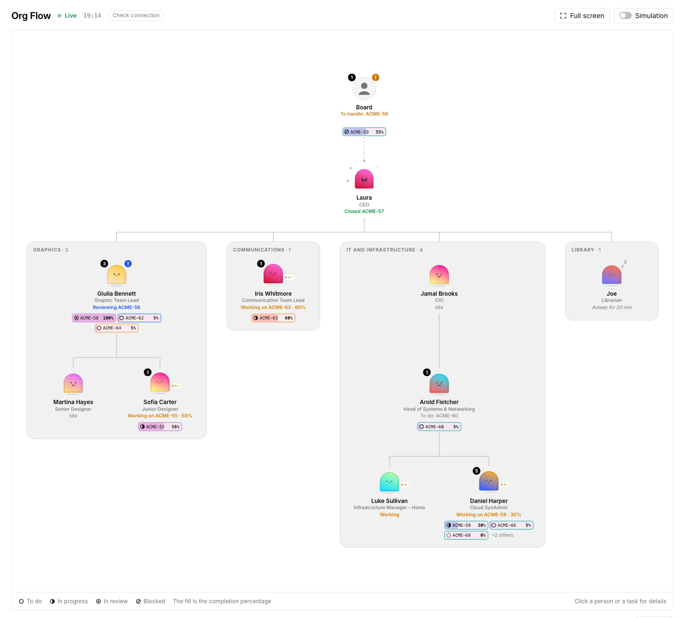

# Agents and the percentage: `report_progress`

Paperclip has no "percentage" field on tasks. Org Flow derives it from several sources ([states-and-percentages.md](states-and-percentages.md#task-percentage)); the most precise is the one the agent declares itself with the `report_progress` tool.

**The plugin does not change the agents' instructions.** The tool is registered and works, but no agent knows it should use it until you tell it. Adding it to the instructions (AGENTS.md or equivalent) is the instance owner's decision: it costs a few extra calls per run and slightly changes the agents' behaviour. Without it, percentages come from the plan checklist or from the estimate from the status.

## What it does

1. The agent calls `report_progress` during a run, on a task it is in charge of.
2. The worker checks the parameters and the permissions.
3. It saves the value in the plugin state (the company's `reported-progress` key and the task's `progress` key).
4. It publishes a `progress` record in the feed and recomputes the snapshot.
5. On the Org Flow page the task's chip shows the new percentage, the feed shows "Sofia is at 58% · note", and the task's detail panel says "Percentage reported by the agent" with the note.

Nothing changes in Paperclip: not the task's status, not the assignee, not comments. To close a task you use the normal status change; there is no need to report 100%.

## Registration

- Declared in the manifest (`tools`) and registered in the worker with `ctx.tools.register` (capability `agent.tools.register`).
- Paperclip exposes it with the plugin name as prefix: `franciuto.org-flow:report_progress`. The exact name the agent sees depends on the adapter.
- Display name: "Report progress".
- Check that it is registered:

  ```bash
  paperclipai plugin tools --api-base "https://your-paperclip.example.com:"
  ```

The description the agent reads (in `src/worker/tool.ts`) already says when to use it: at every significant step, roughly every 20–25%, or when the estimate changes, with a short note; only for its own tasks or its subordinates'; there is no need to report 100%.

## Parameters

| Parameter | Type | Required | Rules |
| --- | --- | --- | --- |
| `issue` | string | yes | identifier (`ACME-62`, upper or lower case) or the task's UUID. Leading and trailing spaces removed |
| `percent` | integer | yes | 0–100. Also accepts numbers as text (`"40"`, `"40%"`) and decimals, which it rounds |
| `note` | string | no | at most 200 characters after trimming spaces; empty = no note |

Example call:

```json
{ "issue": "ACME-62", "percent": 60, "note": "Components done, dark theme still missing" }
```

## Validation and errors

Errors go back to the agent as English text, written so it can fix the call by itself.

| Case | Message (summary) |
| --- | --- |
| missing parameters or not an object | "Missing parameters: issue (e.g. ACME-62) and percent (0-100) are required." |
| empty `issue` | "Missing issue parameter: …" |
| non-numeric `percent` | "Invalid percent parameter: it must be a number from 0 to 100." |
| `percent` < 0 or > 100 | "percent parameter out of range (…)" |
| `note` not text | "Invalid note parameter: it must be text." |
| `note` longer than 200 characters | "The note is too long (N characters): maximum 200." |
| run without company or agent | "Incomplete run context: …" |
| task not found in the company | "Task "ACME-99" not found in this company. …" |
| closed task (`done` or `cancelled`) | "Task ACME-62 is already closed (done): there is no need to report progress." |
| someone else's task | "You can only report progress on tasks assigned to you or your subordinates: ACME-62 is assigned to <name>." (or "the board", or "nobody") |

Permissions: the task must be assigned to the calling agent or to an agent who reports to them, directly or along the `reportsTo` chain (a manager can report for a subordinate). Cycles in the chain do not block the check. Tasks assigned to a human user or unassigned are rejected.

Task lookup: first `ctx.issues.get` with the value passed (Paperclip resolves both the id and the identifier); if it does not find it and the value has the form `ABC-123`, it looks for the identifier among the tasks the worker already knows.

Response on success:

```json
{
  "content": "Progress recorded: ACME-62 at 60%. Note: \"Components done, dark theme still missing\". The board can now see it in Org Flow.",
  "data": { "issueId": "e2a0…", "identifier": "ACME-62", "percent": 60, "note": "Components done, dark theme still missing", "reportedAt": "2026-03-10T00:50:41.000Z" }
}
```

## How long the value lasts

- It is valid until the agent reports another.
- It is reset if the task is reopened or passes to a person other than the one who reported it. It then goes back to the checklist or the estimate, and the new assignee can report their own.
- It stays if only the status changes (e.g. `in_progress` → `in_review`).
- When the task is `done` the percentage is 100 anyway.
- Values older than 30 days are discarded.

## How it appears

- **Chip in the org chart**: fill and number updated as soon as the event arrives (polling every 3 s).
- **"Live activity" feed**: a row with the agent's character in `working` pose, "is at **60%**" and the note (cut to 60 characters, in full on mouse hover).
- **Task detail panel**: large bar, "Percentage reported by the agent · “note”".
- The agent's visual state does not change on a `report_progress`; it does count as activity, though (it keeps the agent from falling asleep).



## Ready-made text for the agents' instructions

To paste into AGENTS.md (or into the role's instructions) **only if the instance owner decides to adopt it**. It suits all the agents that work on tasks.

```markdown
## Task progress (Org Flow)

The board follows the work in Org Flow, which shows the completion percentage of every task.
When you work on a task assigned to you, report your progress with the `report_progress` tool:

- call it when you complete a significant step (about every 20-25%) or when your estimate changes;
- parameters: `issue` = the task identifier (e.g. ACME-62), `percent` = an integer from 0 to 100,
  `note` = optional, at most 200 characters, on what you did or what is missing;
- the percentage is an honest estimate of the work done, not of the time spent;
- there is no need to report 100%: to close the task, change its status as usual;
- it does not change the task's status and does not replace comments;
- if you manage other agents you can also report it on your subordinates' tasks;
- if the tool answers with an error, read the message, fix the parameters and try once more;
  if it is not available, carry on without it.

Example: `report_progress({ "issue": "ACME-62", "percent": 60, "note": "Components done, dark theme still missing" })`
```

Alternatively, without changing the instructions, you can ask the agents to keep a checklist (`- [ ]` / `- [x]`) in the task's `plan` document: Org Flow counts it by itself.
