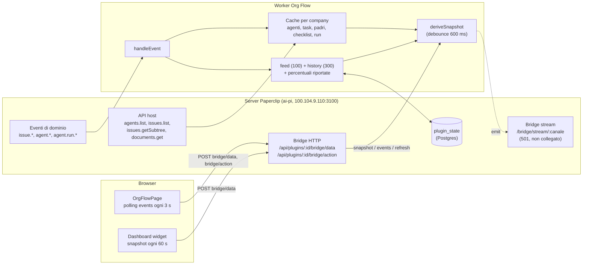

# Architettura

Come è fatto Org Flow dentro Paperclip: i pezzi, il percorso dei dati dagli eventi allo schermo, cosa resta in memoria e cosa nel database, i limiti dell'host e come il codice li aggira.

Le regole di dettaglio (stati, percentuali) sono in [stati-e-percentuali.md](stati-e-percentuali.md); i tipi scambiati sono in [contratto-dati.md](contratto-dati.md).

## Componenti

| Componente | File | Dove gira | Cosa fa |
| --- | --- | --- | --- |
| Manifest | `src/manifest.ts` → `dist/manifest.js` | letto da Paperclip all'installazione e a ogni ricarica | id `franciuto.org-flow`, capability, slot UI, schema delle impostazioni, strumento `report_progress` |
| Worker | `src/worker.ts`, `src/worker/*.ts` → `dist/worker.js` | processo Node separato, avviato da Paperclip su `ai-pi` | riceve gli eventi, legge agenti/task/documenti, tiene le cache, costruisce lo snapshot, risponde al bridge, esegue `report_progress` |
| UI | `src/ui/**` → `dist/ui/index.js` | browser, dentro la pagina di Paperclip | pagina `/<prefisso>/org-flow`, link nella barra laterale, riquadro nella Dashboard |
| Contratto | `src/shared/types.ts` | importato da worker e UI | tipi JSON scambiati e chiavi del bridge |

Il worker è diviso in moduli puri (senza chiamate all'host, testabili da soli) e un modulo con lo stato:

| Modulo | Ruolo |
| --- | --- |
| `worker/feed.ts` | evento Paperclip → `FeedRecord`; paginazione degli eventi per il polling |
| `worker/history.ts` | cronologia dei passaggi (`HistoryEntry`), percorsi, rimbalzi, segnali per persona |
| `worker/progress.ts` | stima dallo stato, lettura della checklist, ordine delle fonti della percentuale |
| `worker/presence.ts` | stato visivo ed etichetta di ogni persona |
| `worker/snapshot.ts` | assemblaggio dello `Snapshot` dai dati in cache |
| `worker/colors.ts` | colore stabile di ogni task padre |
| `worker/settings.ts` | schema, valori predefiniti e validazione delle impostazioni |
| `worker/tool.ts` | dichiarazione e validazione dei parametri di `report_progress` |
| `worker/service.ts` | stato per company, cache, chiamate all'host, gestori degli eventi e del bridge |

La UI ha la stessa separazione: `ui/model.ts`, `ui/presence.ts`, `ui/poll.ts`, `ui/layout.ts`, `ui/chips.ts`, `ui/format.ts`, `ui/simulator.ts` sono puri; `ui/useLive.tsx` e `ui/hooks.ts` contengono gli hook React; `ui/components/*` i componenti.

## Flusso dei dati

Passo per passo, quando un agente passa un task a un altro:

1. Paperclip emette `issue.updated` con `changes.assigneeAgentId`. Il worker lo riceve in `handleEvent` (`service.ts`).
2. `recordFromIssueEvent` (`feed.ts`) lo trasforma in un `FeedRecord` di tipo `handoff`. Gli aggiornamenti che non toccano stato, assegnatario, titolo, padre, priorità o chiusura vengono ignorati (`RELEVANT_CHANGES`).
3. Il worker rilegge il task con `ctx.issues.get` e aggiorna la copia in cache (`patchIssue`); se la lettura fallisce applica quello che dice l'evento. Aggiunge identificatore, titolo, padre e nomi delle persone (arricchimento). Un errore di arricchimento non fa cadere l'evento.
4. `publish` mette il record in testa al feed, aggiunge una voce alla cronologia (`entryFromRecord`), gli assegna un numero di sequenza per il polling, lo emette sullo stream e salva feed e cronologia nello stato del plugin.
5. Dopo 600 ms senza altri eventi (`SNAPSHOT_DEBOUNCE_MS`) il worker ricostruisce lo snapshot. Lo stream non arriva al browser (vedi sotto), ma lo snapshot resta pronto in memoria.
6. La pagina interroga `events` ogni 3 s con il cursore dell'ultima pagina. Riceve il nuovo record e reagisce subito: il chip vola dal vecchio al nuovo assegnatario, chi riceve passa per qualche secondo a "Ha ricevuto …", il feed si aggiorna.
7. La risposta di `events` contiene `snapshotAt`; se è più recente dello snapshot mostrato, la pagina richiede `snapshot` (dopo 250 ms) e sostituisce i dati. Le modifiche locali fatte al punto 6 vengono scartate appena arriva uno snapshot generato dopo l'evento.

## Polling al posto dello stream

L'SDK prevede uno stream in tempo reale (`ctx.streams.emit` nel worker, `usePluginStream` nella UI). In Paperclip 2026.1023.0 (e anche nella 2026.1106.0) il server non collega lo "stream bus" alle rotte dei plugin: `GET /api/plugins/:id/bridge/stream/:canale` risponde 501. Il canale è quindi muto.

La UI usa il polling come canale principale (`src/ui/useLive.tsx`):

| Richiesta | Frequenza | Costante |
| --- | --- | --- |
| `events` con `after = cursore` | 3 s dopo la risposta precedente; 6 s dopo un errore; 30 s se lo stream fosse collegato | `POLL_MS`, `POLL_MS_AFTER_ERROR`, `POLL_MS_WITH_STREAM` |
| `snapshot` | ogni 30 s, più 700 ms dopo record nuovi e 250 ms dopo un `snapshotAt` più recente; mai due richieste insieme | `SNAPSHOT_REFRESH_MS` |
| azione `refresh` | ogni 60 s, una alla volta (spenta in simulazione) | `ACTION_REFRESH_MS` |
| widget: `snapshot` | ogni 60 s | `WIDGET_REFRESH_MS` in `Widget.tsx` |

Il polling si autoregola (`src/ui/poll.ts`): la richiesta successiva parte solo dopo che la precedente ha risposto, perché `refresh()` dell'host annulla la richiesta in corso senza interromperla e un timer fisso potrebbe non ricevere mai risposta con un host lento. Una richiesta senza risposta da 15 s (`POLL_CEILING_MS`) viene considerata persa e ripetuta. Se 5 pagine di fila non portano record mentre `snapshotAt` cambia, il cursore viene azzerato (`watchCursor`).

Con la scheda del browser nascosta (`document.hidden`) la pagina non interroga. `events` è servito dalla memoria del worker, senza chiamate all'host: il costo è trascurabile.

Il worker continua a emettere sullo stream (`emitStream`). Se una versione futura di Paperclip lo collega, `usePluginStream` risulta connesso, la UI usa i messaggi dello stream e rallenta il polling a 30 s, senza modifiche al codice.

## Cache e tempi

Tutto vive nel worker, per company (`CompanyRuntime` in `service.ts`). Valori attuali:

| Dato | Fonte host | Validità | Note |
| --- | --- | --- | --- |
| Impostazioni | `ctx.config.get(companyId)` | 60 s | `onConfigChanged` le aggiorna subito |
| Agenti | `ctx.agents.list` | 60 s | invalidati da `agent.created/updated/error_cleared`; se la lettura fallisce resta la lista precedente |
| Task aperti | `ctx.issues.list` per stato (`backlog`, `todo`, `in_progress`, `in_review`, `blocked`) | 60 s o finché un evento li segna da rifare (`baseDirty`) | |
| Task chiusi | `ctx.issues.list` per `done` e `cancelled` | 5 min | tra due letture gli eventi li aggiornano |
| Padri e conteggio figli | `ctx.issues.getSubtree(id, { includeRoot: true })` | 5 min; 30 s se il padre non è leggibile | i figli nascosti (`hiddenAt`) non contano |
| Checklist del piano | `ctx.issues.documents.get(id, "plan")` | 10 min | invalidata da `issue.document.*` con chiave `plan` |
| Snapshot derivato | calcolo locale | ricalcolato almeno ogni 20 s | serve per gli stati che dipendono dal tempo (es. "Dorme") |

Le letture parallele sono al massimo 6 (`MAX_PARALLEL`). Lo snapshot ha un'impronta (`snapshotFingerprint`): se il contenuto non cambia, `generatedAt` resta lo stesso e la UI non scarica di nuovo nulla.

Il "modello base" (`BaseModel`) contiene i task aperti più i chiusi nelle ultime `max(keepClosedHours, 24)` ore; lo snapshot mostra solo i chiusi nelle ultime `keepClosedHours` ore. Le 24 ore minime servono al contatore "chiusi nelle ultime 24 h".

## Cosa è salvato nello stato del plugin

Lo stato del plugin è la tabella `plugin_state` del database di Paperclip (Postgres embedded, porta 54329). Chiavi usate:

| Scope | Chiave | Contenuto | Limite |
| --- | --- | --- | --- |
| `company` | `feed` | ultimi `FeedRecord`, dal più recente | 100 |
| `company` | `history` | voci di cronologia (`HistoryEntry`: creazione, passaggio, cambio di stato) | 300 |
| `company` | `reported-progress` | percentuali riportate dagli agenti, per id del task | voci più vecchie di 30 giorni scartate |
| `issue` | `progress` | copia della percentuale riportata sul singolo task | scritta e cancellata, oggi non riletta |
| `company` | `recent-feed` | feed della 0.1.0 | letto solo se `feed` è vuoto, mai scritto |

Non è salvato: cache dei task e degli agenti, run in corso, ultimo valore noto per la stima dei task bloccati, snapshot. Dopo un riavvio del worker si ricostruiscono dall'host e dal feed salvato.

Al primo accesso a una company il worker legge `feed`, `history` e `reported-progress`. Se la lettura fallisce non salva niente finché non riesce a rileggere (riprova dopo 10 s, `LOAD_RETRY_MS`): un salvataggio con una cronologia quasi vuota cancellerebbe quella vera.

Per vedere lo stato salvato serve `psql` sul database; vedi [installazione.md](installazione.md#ispezionare-lo-stato-salvato).

## Più company

Il plugin dichiara `multiCompanyConfig: true`. Ogni company ha:

- il suo `CompanyRuntime` in memoria (cache, feed, cronologia, run);
- le sue impostazioni (`ctx.config.get(companyId)`);
- le sue chiavi di stato (scope `company`, `scopeId = companyId`);
- il suo canale stream (`ctx.streams.open(canale, companyId)` prima di ogni emissione).

La company viene dal contesto: per gli eventi `ev.companyId`; per il bridge il `companyId` autorizzato dall'host, che prevale su quello nei parametri; per lo strumento `runCtx.companyId`. Oggi in produzione c'è una sola company (`franciuto.com`, prefisso `FRA`).

## Limiti dell'host e come sono aggirati

Fatti verificati su Paperclip 2026.1023.0 (commento in testa a `src/worker/service.ts`):

| Limite | Effetto | Soluzione nel codice |
| --- | --- | --- |
| Stream bridge non collegato (501) | `usePluginStream` non si connette mai | polling di `events` ogni 3 s; lo stream resta come canale opzionale |
| Chiamate all'host dopo che un gestore data/action/tool ha risposto vengono rifiutate (invocazione scaduta) | un lavoro "in coda" partito da una richiesta del browser fallirebbe | `ping`, `refresh` e `report_progress` completano tutto (anche lo snapshot) prima di rispondere; i lavori ritardati (debounce dello snapshot) partono solo da gestori di eventi, il cui scope resta valido circa 15 minuti |
| `ctx.streams.emit` usa la company dell'ultimo `ctx.streams.open` | con più company un messaggio finirebbe alla company sbagliata | `open` + `emit` nello stesso tick per la company giusta (`emitStream`) |
| `ctx.issues.list` inoltra solo alcuni filtri; la paginazione con `offset` non è affidabile | filtri ignorati, pagine incomplete | una chiamata per stato, senza `limit` |
| `ctx.issues.getSubtree` legge la tabella direttamente | restituisce anche i task nascosti | filtrati quelli con `hiddenAt` |
| `agent.status_changed` non viene mai emesso | lo stato degli agenti (es. `running`) non arriva per evento | lo stato si deduce dai run (`agent.run.started` → `running`, fine run → `idle`) e si rilegge la lista agenti su `agent.updated` (pausa, ripresa) |
| I run spostano i task senza evento di attività (checkout → `in_progress`, sblocco automatico) | lo stato dei task resterebbe vecchio | ogni evento di run segna il modello da ricostruire |
| `issues.list` riporta il run in corso (`activeRun`) | utile dopo un riavvio, quando gli eventi `run.started` sono persi | il run riportato dall'host vale finché non è noto un run finito più recente; un run senza fine da più di 6 ore viene ignorato (`STALE_RUN_MS`) |

## Modi di guasto

| Cosa fallisce | Comportamento |
| --- | --- |
| Lettura di task o agenti durante la costruzione | si tengono i dati precedenti; `health` è `degraded` per 5 minuti con il messaggio dell'errore; warning nei log |
| Lettura di un task padre (cancellato, non leggibile) | i figli diventano "Senza padre"; nuovo tentativo dopo 30 s |
| Lettura del documento `plan` | niente checklist, si passa alla stima dallo stato |
| Arricchimento di un evento (nomi, titolo) | il record viene pubblicato lo stesso con i dati dell'evento |
| Lettura dello stato del plugin | feed e cronologia restano solo in memoria e non vengono salvati; nuovo tentativo dopo 10 s |
| Scrittura dello stato | warning; i dati restano in memoria fino al prossimo salvataggio riuscito |
| Emissione sullo stream | warning, nessun effetto visibile (lo stream è comunque muto) |
| Riavvio del worker (ricarica dopo un build, aggiornamento di Paperclip) | cache vuote, ricostruite alla prima richiesta; feed, cronologia e percentuali riportate riletti dallo stato; il cursore di polling cambia "epoca" e la pagina riceve gli ultimi 20 eventi, che scarta per id |
| Polling fallito dal browser | indicatore "Connessione…", poi "Non raggiungibile" dopo 3 errori consecutivi; tra un tentativo e l'altro 6 s; resta visibile l'ultimo snapshot |
| Worker non pronto (stato del plugin diverso da `ready`) | il bridge risponde 502 `WORKER_UNAVAILABLE`; la pagina mostra l'errore se non ha mai ricevuto uno snapshot |

Diagnosi passo per passo in [risoluzione-problemi.md](risoluzione-problemi.md).
