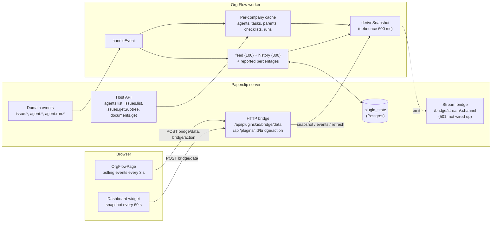

# Architecture

Org Flow has three parts. The plugin worker is a Node process started by Paperclip: it listens to events, reads agents and tasks, and builds the snapshot. The UI runs in the browser inside the Paperclip page and shows the org chart. The saved state is a set of keys in the Paperclip database, where the worker keeps the activity feed, the history and the reported percentages.

This document covers how Org Flow is built inside Paperclip: the pieces, the path of data from events to the screen, what stays in memory and what goes in the database, the host's limitations and how the code works around them.

The detailed rules (statuses, percentages) are in [states-and-percentages.md](states-and-percentages.md); the exchanged types are in [data-contract.md](data-contract.md).

## Components

| Component | File | Where it runs | What it does |
| --- | --- | --- | --- |
| Manifest | `src/manifest.ts` → `dist/manifest.js` | read by Paperclip at install time and on every reload | id `franciuto.org-flow`, capabilities, UI slots, settings schema, `report_progress` tool |
| Worker | `src/worker.ts`, `src/worker/*.ts` → `dist/worker.js` | separate Node process, started by Paperclip | receives events, reads agents/tasks/documents, keeps the caches, builds the snapshot, answers the bridge, runs `report_progress` |
| UI | `src/ui/**` → `dist/ui/index.js` | browser, inside the Paperclip page | page `/<prefix>/org-flow`, sidebar link, widget in the Dashboard |
| Contract | `src/shared/types.ts` | imported by worker and UI | JSON types exchanged and bridge keys |

The worker is split into pure modules (no host calls, testable on their own) and one module that holds the state:

| Module | Role |
| --- | --- |
| `worker/feed.ts` | Paperclip event → `FeedRecord`; event pagination for polling |
| `worker/history.ts` | history of handoffs (`HistoryEntry`), journeys, bounces, per-person signals |
| `worker/progress.ts` | estimate from the status, checklist reading, order of the percentage sources |
| `worker/presence.ts` | visual state and label of each person |
| `worker/snapshot.ts` | assembly of the `Snapshot` from the cached data |
| `worker/colors.ts` | stable colour of each parent task |
| `worker/settings.ts` | schema, default values and validation of the settings |
| `worker/tool.ts` | declaration and validation of the `report_progress` parameters |
| `worker/service.ts` | per-company state, caches, host calls, event and bridge handlers |

The UI has the same separation: `ui/model.ts`, `ui/presence.ts`, `ui/poll.ts`, `ui/layout.ts`, `ui/chips.ts`, `ui/format.ts`, `ui/simulator.ts` are pure; `ui/useLive.tsx` and `ui/hooks.ts` contain the React hooks; `ui/components/*` the components.

## Data flow

Step by step, when an agent hands a task to another one:

1. Paperclip emits `issue.updated` with `changes.assigneeAgentId`. The worker receives it in `handleEvent` (`service.ts`).
2. `recordFromIssueEvent` (`feed.ts`) turns it into a `FeedRecord` of kind `handoff`. Updates that do not touch status, assignee, title, parent, priority or closure are ignored (`RELEVANT_CHANGES`).
3. The worker re-reads the task with `ctx.issues.get` and updates the cached copy (`patchIssue`); if the read fails it applies what the event says. It adds identifier, title, parent and people's names (enrichment). An enrichment error does not bring the event down.
4. `publish` puts the record at the head of the activity feed, adds an entry to the history (`entryFromRecord`), assigns it a sequence number for polling, emits it on the stream and saves feed and history in the plugin state.
5. After 600 ms with no further events (`SNAPSHOT_DEBOUNCE_MS`) the worker rebuilds the snapshot. The stream does not reach the browser (see below), but the snapshot stays ready in memory.
6. The page queries `events` every 3 s with the cursor of the last page. It receives the new record and reacts immediately: the chip flies from the old assignee to the new one, the receiver switches for a few seconds to "Received …", the activity feed updates.
7. The `events` response contains `snapshotAt`; if it is more recent than the displayed snapshot, the page requests `snapshot` (after 250 ms) and replaces the data. The local changes made at step 6 are discarded as soon as a snapshot generated after the event arrives.

## Polling instead of the stream

The SDK provides a real-time stream (`ctx.streams.emit` in the worker, `usePluginStream` in the UI). In Paperclip 2026.1023.0 (and also in 2026.1106.0) the server does not connect the "stream bus" to the plugin routes: `GET /api/plugins/:id/bridge/stream/:channel` answers 501. The channel is therefore silent.

The UI uses polling as its main channel (`src/ui/useLive.tsx`):

| Request | Frequency | Constant |
| --- | --- | --- |
| `events` with `after = cursor` | 3 s after the previous response; 6 s after an error; 30 s if the stream were connected | `POLL_MS`, `POLL_MS_AFTER_ERROR`, `POLL_MS_WITH_STREAM` |
| `snapshot` | every 30 s, plus 700 ms after new records and 250 ms after a more recent `snapshotAt`; never two requests at once | `SNAPSHOT_REFRESH_MS` |
| `refresh` action | every 60 s, one at a time (off in Simulation) | `ACTION_REFRESH_MS` |
| widget: `snapshot` | every 60 s | `WIDGET_REFRESH_MS` in `Widget.tsx` |

Polling regulates itself (`src/ui/poll.ts`): the next request starts only after the previous one has answered, because the host's `refresh()` cancels the request in progress without interrupting it and a fixed timer might never get an answer from a slow host. A request with no answer for 15 s (`POLL_CEILING_MS`) is considered lost and repeated. If 5 pages in a row bring no records while `snapshotAt` changes, the cursor is reset (`watchCursor`).

With the browser tab hidden (`document.hidden`) the page does not poll. `events` is served from the worker's memory, with no host calls: the cost is negligible.

The worker keeps emitting on the stream (`emitStream`). If a future version of Paperclip wires it up, `usePluginStream` becomes connected, the UI uses the stream messages and slows polling down to 30 s, with no code changes.

## Caches and timing

Everything lives in the worker, per company (`CompanyRuntime` in `service.ts`). Current values:

| Data | Host source | Validity | Notes |
| --- | --- | --- | --- |
| Settings | `ctx.config.get(companyId)` | 60 s | `onConfigChanged` updates them immediately |
| Agents | `ctx.agents.list` | 60 s | invalidated by `agent.created/updated/error_cleared`; if the read fails the previous list stays |
| Open tasks | `ctx.issues.list` per status (`backlog`, `todo`, `in_progress`, `in_review`, `blocked`) | 60 s or until an event marks them to be redone (`baseDirty`) | |
| Closed tasks | `ctx.issues.list` for `done` and `cancelled` | 5 min | between two reads, events update them |
| Parents and child count | `ctx.issues.getSubtree(id, { includeRoot: true })` | 5 min; 30 s if the parent is not readable | hidden children (`hiddenAt`) do not count |
| Plan checklist | `ctx.issues.documents.get(id, "plan")` | 10 min | invalidated by `issue.document.*` with key `plan` |
| Derived snapshot | local computation | recomputed at least every 20 s | needed for time-dependent states (e.g. "Asleep") |

There are at most 6 parallel reads (`MAX_PARALLEL`). The snapshot has a fingerprint (`snapshotFingerprint`): if the content does not change, `generatedAt` stays the same and the UI downloads nothing again.

The "base model" (`BaseModel`) contains the open tasks plus those closed in the last `max(keepClosedHours, 24)` hours; the snapshot shows only those closed in the last `keepClosedHours` hours. The 24-hour minimum is needed for the "closed in the last 24 h" counter.

## What is saved in the plugin state

The plugin state is the `plugin_state` table in the Paperclip database (embedded Postgres, port 54329). Keys used:

| Scope | Key | Content | Limit |
| --- | --- | --- | --- |
| `company` | `feed` | latest `FeedRecord`s, most recent first | 100 |
| `company` | `history` | history entries (`HistoryEntry`: creation, handoff, status change) | 300 |
| `company` | `reported-progress` | percentages reported by the agents, by task id | entries older than 30 days discarded |
| `issue` | `progress` | copy of the reported percentage on the individual task | written and deleted, currently not read back |
| `company` | `recent-feed` | activity feed of 0.1.0 | read only if `feed` is empty, never written |

Not saved: task and agent caches, runs in progress, last known value for the estimate of blocked tasks, snapshot. After a worker restart they are rebuilt from the host and from the saved feed.

On first access to a company the worker reads `feed`, `history` and `reported-progress`. If the read fails it saves nothing until it manages to read again (retries after 10 s, `LOAD_RETRY_MS`): a save with an almost empty history would erase the real one.

To see the saved state you need `psql` on the database; see [installation.md](installation.md#inspecting-the-saved-state).

## Multiple companies

The plugin declares `multiCompanyConfig: true`. Each company has:

- its own `CompanyRuntime` in memory (cache, activity feed, history, runs);
- its own settings (`ctx.config.get(companyId)`);
- its own state keys (scope `company`, `scopeId = companyId`);
- its own stream channel (`ctx.streams.open(channel, companyId)` before every emission).

The company comes from the context: for events `ev.companyId`; for the bridge the `companyId` authorised by the host, which takes precedence over the one in the parameters; for the tool `runCtx.companyId`. A single company works the same way, with one runtime.

## Host limitations and how they are worked around

Facts verified on Paperclip 2026.1023.0 (comment at the top of `src/worker/service.ts`):

| Limitation | Effect | Solution in the code |
| --- | --- | --- |
| Stream bridge not wired up (501) | `usePluginStream` never connects | polling of `events` every 3 s; the stream stays as an optional channel |
| Host calls made after a data/action/tool handler has answered are rejected (expired invocation) | a "queued" job started from a browser request would fail | `ping`, `refresh` and `report_progress` complete everything (the snapshot too) before answering; delayed jobs (snapshot debounce) start only from event handlers, whose scope stays valid for about 15 minutes |
| `ctx.streams.emit` uses the company of the last `ctx.streams.open` | with several companies a message would end up at the wrong company | `open` + `emit` in the same tick for the right company (`emitStream`) |
| `ctx.issues.list` forwards only some filters; pagination with `offset` is unreliable | ignored filters, incomplete pages | one call per status, without `limit` |
| `ctx.issues.getSubtree` reads the table directly | also returns hidden tasks | those with `hiddenAt` are filtered out |
| `agent.status_changed` is never emitted | the agents' status (e.g. `running`) does not arrive by event | the status is deduced from the runs (`agent.run.started` → `running`, end of run → `idle`) and the agent list is re-read on `agent.updated` (pause, resume) |
| Runs move tasks without an activity event (checkout → `in_progress`, automatic unblock) | the task status would stay stale | every run event marks the model to be rebuilt |
| `issues.list` reports the run in progress (`activeRun`) | useful after a restart, when the `run.started` events are lost | the run reported by the host is valid until a more recent finished run is known; a run with no end for more than 6 hours is ignored (`STALE_RUN_MS`) |

## Failure modes

| What fails | Behaviour |
| --- | --- |
| Reading tasks or agents during the build | the previous data is kept; `health` is `degraded` for 5 minutes with the error message; warning in the logs |
| Reading a parent task (deleted, not readable) | the children become "No parent"; new attempt after 30 s |
| Reading the `plan` document | no checklist, falls back to the estimate from the status |
| Enrichment of an event (names, title) | the record is published anyway with the event's data |
| Reading the plugin state | activity feed and history stay only in memory and are not saved; new attempt after 10 s |
| Writing the state | warning; the data stays in memory until the next successful save |
| Emission on the stream | warning, no visible effect (the stream is silent anyway) |
| Worker restart (reload after a build, Paperclip update) | empty caches, rebuilt on the first request; activity feed, history and reported percentages re-read from the state; the polling cursor changes "epoch" and the page receives the last 20 events, which it discards by id |
| Polling failed from the browser | "Connecting…" indicator, then "Unreachable" after 3 consecutive errors; 6 s between attempts; the last snapshot stays visible |
| Worker not ready (plugin status other than `ready`) | the bridge answers 502 `WORKER_UNAVAILABLE`; the page shows the error if it has never received a snapshot |

Step-by-step diagnosis in [troubleshooting.md](troubleshooting.md).
