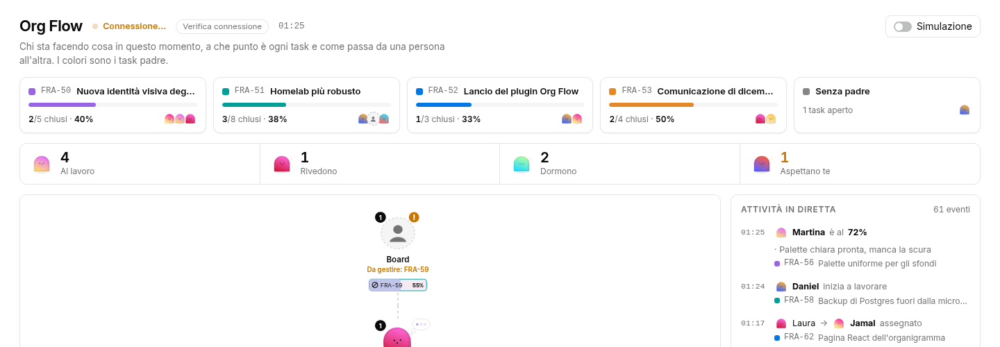

# Risoluzione dei problemi

Sintomo → cause probabili → cosa fare. I comandi presuppongono le variabili di [installazione.md](installazione.md):

```bash
export PATH="$HOME/.local/node/bin:$PATH"
PC="paperclipai --api-base https://agents.franciuto.com:"
```

e, per `curl`, `TOKEN`, `BASE`, `CO` come in [installazione.md](installazione.md#bridge-con-curl).

Primo controllo, quasi sempre utile:

```bash
$PC plugin list                       # stato, versione, packagePath
$PC plugin logs franciuto.org-flow    # warning "org-flow: …"
```

## La pagina dice "Non raggiungibile"

L'indicatore accanto al titolo segue il polling di `events`: "Live" (verde) se le richieste riescono, "Connessione…" (giallo) prima della prima risposta o dopo un errore, "Non raggiungibile" (rosso) dopo 3 errori consecutivi. La pagina continua a mostrare l'ultimo snapshot ricevuto.



| Causa | Verifica | Rimedio |
| --- | --- | --- |
| Plugin non `ready` (errore, disabilitato, `upgrade_pending`) | `$PC plugin list` | vedi [Plugin in stato error](#plugin-in-stato-error) o approva le capability |
| Worker in riavvio (subito dopo un build) | `$PC plugin logs franciuto.org-flow` | aspetta qualche secondo: torna "Live" da solo |
| Paperclip fermo o non raggiungibile | `curl -sS -o /dev/null -w '%{http_code}\n' https://agents.franciuto.com/api/health` | riavvia Paperclip; controlla tailnet e pubblicazione |
| Sessione del browser scaduta | le altre pagine di Paperclip rimandano al login | rifai il login |
| Errore nel worker sulla richiesta `events` | `curl` su `events` (sotto) risponde 502 | leggi il messaggio e i log |

```bash
curl -sS -X POST "$BASE/bridge/data" -H "Authorization: Bearer $TOKEN" -H "Content-Type: application/json" \
  -d "{\"key\":\"events\",\"companyId\":\"$CO\",\"params\":{}}" | head -c 300; echo
```

Con la scheda del browser in background il polling si ferma; al ritorno riprende.

## "Non riesco a leggere i dati del plugin: …"

Compare quando la pagina non ha mai ricevuto uno snapshot e la richiesta `snapshot` fallisce. Il testo dopo i due punti è l'errore dell'host o del worker. La pagina riprova da sola ogni 30 s.

- `Plugin is not ready (current status: …)`: il plugin non è `ready`, vedi sotto.
- Altri messaggi: errore nel worker durante la costruzione. `$PC plugin logs franciuto.org-flow` e il `curl` su `snapshot`.

## Plugin in stato `error`

| Causa | Indizio | Rimedio |
| --- | --- | --- |
| `dist/` mancante o incompleto (build fallito o non fatto) | `lastError` cita `dist/worker.js` o `dist/manifest.js` | `cd ~/ai-final-boss/paperclip-plugins/org-flow && npm ci && npm run build` |
| Dipendenze mancanti dopo un `git pull` | errore di import | `npm ci && npm run build` |
| Manifest non valido | errore di validazione | `npm test` (`tests/manifest.spec.ts` usa il validatore dell'host) |
| Eccezione nel `setup` del worker | stack trace nei log | correggi, ricostruisci |
| Percorso di installazione spostato o cancellato | `packagePath` in `$PC plugin inspect franciuto.org-flow` non esiste | reinstalla dal percorso giusto ([installazione.md](installazione.md#prima-installazione)) |

Dopo la correzione: il build fa ricaricare il plugin; se resta in errore `$PC plugin enable franciuto.org-flow`. Paperclip ritenta comunque una volta, all'avvio, i plugin in errore.

## Lo stato è `upgrade_pending`

La versione nuova dichiara capability che quella registrata non aveva. Il worker resta fermo finché l'amministratore non le approva dalla pagina del plugin nelle impostazioni dell'istanza. In alternativa: disinstallazione senza `--force` e reinstallazione dal submodule.

## Nessun personaggio nell'organigramma

| Sintomo | Causa | Rimedio |
| --- | --- | --- |
| "Nessun agente in questa company." | `agents.list` vuoto o fallito al primo caricamento | log: `org-flow: elenco agenti non disponibile`; aspetta 60 s o ricarica la pagina (l'azione `refresh` rilegge gli agenti) |
| Persone presenti ma cerchi con le iniziali invece dei personaggi | l'agente non ha `appearance.paletteId` | imposta l'aspetto dell'agente in Paperclip |
| Immagini rotte | `/api/agent-avatars/cap-v1/<palette>/<posa>.png` non risponde (versione di Paperclip diversa, sessione scaduta) | apri l'URL dell'immagine nel browser; se l'host ha cambiato percorso, aggiorna `poseUrl` in `src/ui/format.ts` |
| Un agente manca | è terminato e non ha task in mano | normale: gli agenti terminati compaiono solo se hanno task |
| Compare un nodo "Altri" (icona `···`) | ci sono task aperti assegnati a qualcuno che non è tra le persone dell'organigramma (es. agente filtrato o non più leggibile); la pagina li raccoglie lì per non perderli (`bucketUnknownHolders` in `src/ui/model.ts`) | apri il task da "Altri" e controlla l'assegnatario in Paperclip |
| Un agente è in cima invece che sotto il suo responsabile | il responsabile (`reportsTo`) non è tra le persone mostrate, oppure c'è un ciclo nella catena | controlla `reportsTo` in Paperclip |

## Le percentuali sono sempre "stimata dallo stato"

È il comportamento atteso senza altre fonti: la stima usa solo lo stato (`todo` 5, `in_progress` 40, `in_review` 85, …).

| Fonte che manca | Perché | Cosa fare |
| --- | --- | --- |
| Valore riportato | gli agenti non usano `report_progress`: le loro istruzioni non sono state modificate | decisione del proprietario, testo pronto in [agenti-e-percentuale.md](agenti-e-percentuale.md) |
| Checklist | il task non ha un documento con chiave `plan`, o il piano non ha caselle `- [ ]` / `- [x]` | chiedere agli agenti una checklist nel piano |
| Checklist presente ma ignorata | il task ha un valore riportato (vince), è un padre (vincono i figli), è chiuso, o il documento è cambiato da meno di 10 minuti senza evento | aspetta, o forza con un ricaricamento della pagina dopo 60 s |
| Sotto-task | il task non ha figli | normale |

La fonte di ogni percentuale è scritta nella scheda del task ("Percentuale …").

## Mancano dei task

| Caso | Spiegazione |
| --- | --- |
| Task chiuso da più di `keepClosedHours` ore (predefinito 24) | non è più mostrato; aumenta l'impostazione se serve |
| Task nascosto in Paperclip (`hiddenAt`) | non compare e non conta tra i figli |
| Task senza assegnatario | non compare sotto nessuna persona (nessun chip), ma conta nei gruppi |
| Persona con più di 4 task | i chip visibili sono 3 più "+N altri"; la lista completa è nella scheda della persona |
| Task appena creato o spostato | il chip arriva con l'evento (≤ 3 s); i dati completi con lo snapshot successivo. Le liste dei task si rileggono al più ogni 60 s, o prima se arriva un evento |
| Cambio fatto da un run senza evento di attività | il worker rilegge le liste a ogni evento di run; altrimenti entro 60 s |
| Filtro attivo | un task padre selezionato nella striscia in alto attenua gli altri gruppi: clicca di nuovo per togliere il filtro |

Controllo diretto:

```bash
curl -sS -X POST "$BASE/bridge/data" -H "Authorization: Bearer $TOKEN" -H "Content-Type: application/json" \
  -d "{\"key\":\"snapshot\",\"companyId\":\"$CO\",\"params\":{}}" \
  | python3 -c 'import json,sys; s=json.load(sys.stdin)["data"]; [print(t["identifier"], t["status"], t["holderId"], t["progress"], t["progressSource"]) for t in s["tasks"]]'
```

## I figli finiscono in "Senza padre"

Il padre non è leggibile (cancellato, nascosto o errore temporaneo). Il worker riprova dopo 30 s. Se il padre esiste, nei log a livello debug c'è `org-flow: task padre non leggibile`.

## Il percorso di un task è corto o manca il "Rimandato"

Il percorso viene dalla cronologia del plugin, che esiste dalla 1.0 e tiene le ultime 300 voci. I passaggi precedenti all'installazione o più vecchi non ci sono. Se manca l'ultimo passaggio, il worker aggiunge comunque l'assegnatario attuale.

## Un agente resta "Al lavoro" o non si sveglia

| Caso | Spiegazione |
| --- | --- |
| Resta "Al lavoro" dopo la fine del run | evento di fine run perso (riavvio del worker durante il run). Il run riportato da Paperclip sul task vale finché non arriva un run finito più recente; dopo 6 ore viene ignorato comunque |
| Non passa a "Dorme" | ha task aperti (chi ha task è "Da fare …", non dorme), oppure ha avuto attività negli ultimi `sleepAfterMinutes` minuti |
| Resta in "Run fallito" | vale 10 minuti dall'ultimo run fallito |
| È "In errore" | stato `error` in Paperclip: si risolve da Paperclip (lo stato si aggiorna su `agent.updated`/`agent.error_cleared`) |

## Il pulsante "Simulazione" non c'è

`enableSimulation` è `false` nelle impostazioni. La simulazione non scrive nulla su Paperclip; quando è attiva compare il riquadro "Simulazione — dati finti" e l'indicatore diventa "Simulazione".

## Il riquadro della Dashboard dice "Dati non disponibili al momento."

Stessa causa di "Non riesco a leggere i dati del plugin": la richiesta `snapshot` fallisce. Il riquadro si aggiorna ogni 60 s.

## Dopo un aggiornamento di Paperclip

1. `$PC plugin list`: se il plugin è `error`, leggi `lastError`. Cause tipiche: API dell'host cambiata, manifest non più valido per la nuova versione.
2. Pagina vuota o errori sul bridge: prova `ping` ([installazione.md](installazione.md#bridge-con-curl)). Se `ping` funziona e `snapshot` no, il problema è in una lettura dell'host (`issues.list`, `getSubtree`, `documents.get`): vedi i log.
3. Lo stream: `curl` su `bridge/stream/org-flow`. Se non è più 501 la UI passa allo stream da sola e il polling rallenta a 30 s.
4. Se l'SDK nuovo è incompatibile: aggiorna `@paperclipai/plugin-sdk` in `package.json`, `npm install`, `npm run typecheck && npm test`, correggi, rilascia.
5. Lo stato salvato (feed, cronologia, percentuali) è nel database e sopravvive. Il codice del plugin è fuori dalla cartella di installazione di Paperclip.

## Dopo un build in sviluppo la produzione è cambiata

La produzione è installata da `~/workdir/Repos/org-flow` invece che dal submodule: Paperclip ricarica il plugin a ogni cambio di `dist/` nella cartella installata. Controlla `packagePath` con `$PC plugin inspect franciuto.org-flow` e reinstalla dal submodule.

## Avvisi nei log

| Messaggio | Significato |
| --- | --- |
| `org-flow: lettura dello stato non riuscita, riprovo più tardi` | il database non ha risposto; feed e cronologia restano in memoria e non vengono salvati finché la lettura non riesce (nuovo tentativo dopo 10 s) |
| `org-flow: salvataggio dello stato non riuscito` | scrittura fallita; i dati restano in memoria |
| `org-flow: costruzione dello snapshot non riuscita, uso i dati precedenti` | lettura di task o agenti fallita; health `degraded` per 5 minuti |
| `org-flow: elenco agenti non disponibile` | `agents.list` fallito; resta la lista precedente |
| `org-flow: lettura del task non riuscita` | arricchimento di un evento fallito; l'evento è pubblicato con i dati che porta |
| `org-flow: invio sullo stream non riuscito` | l'emissione sullo stream ha dato errore; nessun effetto visibile, perché la pagina usa il polling |
| `org-flow: lettura delle impostazioni non riuscita, uso i valori predefiniti` | `config.get` fallito |
