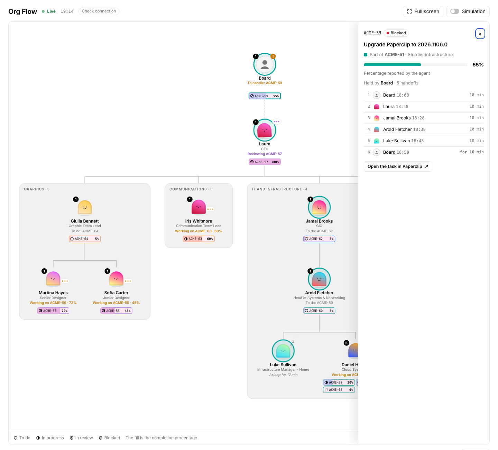
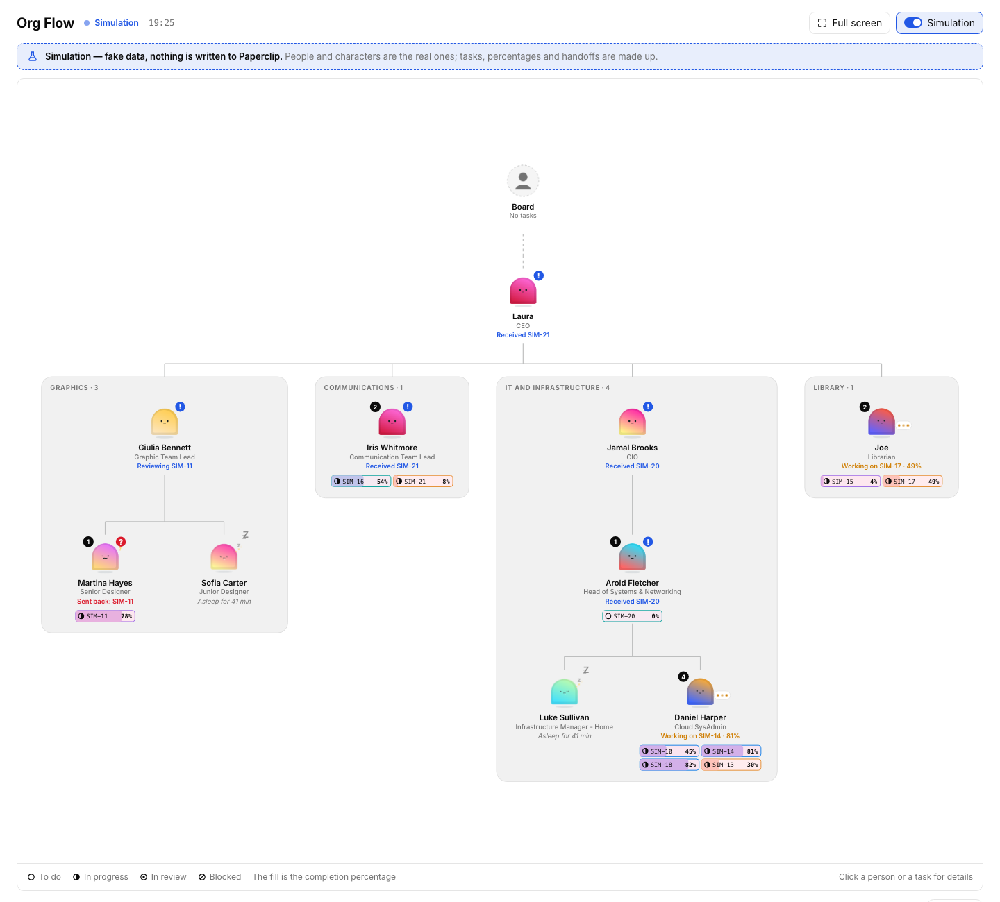

# Visual states and percentages

The exact rules implemented today. The times are constants in the code: the name is given next to each, so the document is easy to keep up to date.

There are two levels:

1. **State computed by the worker** (`src/worker/presence.ts`), recomputed on every snapshot and at least every 20 s.
2. **Immediate effects of the UI** (`src/ui/presence.ts`): when an event arrives the page changes state and task position at once, without waiting for the next snapshot.

## States of people (worker)

### Agents

The rules are evaluated in this order; the first that applies wins.

| # | Condition | State | Pose | Label |
| --- | --- | --- | --- | --- |
| 1 | `agentStatus = terminated` | `paused` | `rest` | "No longer active" |
| 2 | `agentStatus = paused` | `paused` | `rest` | "Paused" |
| 3 | `agentStatus = error` | `confused` | `confused` | "In error" |
| 4 | last run failed in the last 10 min (`RUN_FAILED_WINDOW_MS`) | `confused` | `confused` | "Run failed · ACME-62" (or "Run failed") |
| 5 | one of their tasks was sent back in the last 2 min (`BOUNCE_WINDOW_MS`) | `confused` | `confused` | "Sent back: ACME-62" |
| 6 | closed a task, or one of their tasks was approved, in the last 90 s (`CLOSED_WINDOW_MS`) | `success` | `success` | "Closed ACME-62" |
| 7 | received a task in the last 60 s (`RECEIVED_WINDOW_MS`) | `listening` | `listening` | "Received ACME-62" |
| 8 | run in progress, or `agentStatus = running` | `working` | `working` | "Working on ACME-62 · 40%" (the run's task, otherwise the first `in_progress`); "Working on ACME-62" if the task is not among theirs; "Working" if there is no task |
| 9 | holds a task that is `in_review` | `thinking` | `thinking` | "Reviewing ACME-62" |
| 10 | has open tasks | `idle` | `idle` | one task: "In progress: ACME-62 · 40%", "Blocked: ACME-62" or "To do: ACME-62"; several tasks: "3 tasks to do" |
| 11 | no known activity, or no activity for `sleepAfterMinutes` (default 15) | `sleepy` | `sleepy` | "Asleep" |
| 12 | otherwise | `idle` | `idle` | "Idle" |

Notes:

- A signal dated more than 60 s in the future is ignored (skewed clocks).
- If the task has no identifier, its title shortened to 28 characters is used instead.
- When several tasks are held, the order for choosing the one to show is `in_progress`, `in_review`, `blocked`, `todo`, `backlog`, then the most recently updated.
- "Last activity" is the most recent of: history entries involving the agent, run and `progress` events in the feed, start of the current run, end of the last run, Paperclip's `lastHeartbeatAt`.

#### Where the signals come from

| Signal | Source |
| --- | --- |
| run in progress | `agent.run.started` event with no end; after a restart, the `activeRun` with `running` status that Paperclip reports on the task (it counts only if no more recent finished run is known). A run with no end for more than 6 hours is considered lost (`STALE_RUN_MS`) |
| last run | `agent.run.finished` / `agent.run.failed` followed by the worker, or the same records in the saved feed (the most recent wins). `agent.run.cancelled` closes the run but does not count as the last run |
| received | `created` or `handoff` history entry with the agent as recipient |
| closed | entry that brings the status to `done`. The signal goes to whoever closes (for a `handoff` to `done`, whoever was passing the task, otherwise the assignee); it also goes to whoever receives the closed task and to the agent who took the action (e.g. the reviewer who approves). Human users do not get this extra signal |
| sent back | see [Bounces](#bounces) |

The agent's `running` status does not arrive by event (Paperclip does not emit `agent.status_changed`): the worker sets it on `agent.run.started` and returns it to `idle` at the end of the run, without touching paused or terminated agents.

### Human users (board)

| Condition | State | Label |
| --- | --- | --- |
| has open tasks assigned | `waiting` | "To handle: ACME-59" or "3 tasks to handle" |
| otherwise | `idle` | "No tasks" |

Users are called "Board", "Board 2", … in id order: the plugin does not have the capability to read members' names.

## Immediate effects on the page (UI)

When the page receives a new record (polling or simulation) it applies a "flash" state to the person for a few seconds, moves the task and, for a handoff, makes the chip fly. The first block of events loaded when the page opens animates nothing.

| Record | Effect |
| --- | --- |
| `handoff` to a user | chip in flight, then the user goes to `waiting` "ACME-59 is waiting for you" |
| `handoff` with status from `in_review` to `in_progress`/`todo`/`backlog` | chip in flight, then the recipient is `confused` "Sent back ACME-62" |
| `handoff` with `statusTo = in_review` | chip in flight, then the recipient is `listening` "To review: ACME-62" |
| other `handoff` | chip in flight, then the recipient is `listening` "Received ACME-62" |
| `status` → `done` | the assignee is `success` "Done! ACME-62"; if the action is by another agent, they too are `success` "Approved ACME-62"; the task goes to 100% |
| `status` from `in_review` to `in_progress`/`todo`/`backlog` | the assignee is `confused` "Sent back ACME-62" |
| `status` → `blocked` | `confused` "Blocked on ACME-62" |
| `status` → `in_review` | `thinking` "Reviewing ACME-62" |
| `created` | the assignee is `listening` "New task: ACME-62" (`waiting` if a user) |
| `run_started` | the agent is `working` "Working on ACME-62" or "Working" |
| `run_finished` | removes the agent's flash |
| `run_failed` | `confused` "Run failed" |
| `progress` | updates only the task's percentage |

Times (`src/ui/presence.ts`):

| Constant | Value | Use |
| --- | --- | --- |
| `FLIGHT_MS` | 1.1 s | duration of the flight; the recipient's flash starts on landing |
| `FLASH_MS` | 4.2 s | duration of the flashes |
| `SUCCESS_FLASH_MS` | 5.2 s | `success` flash |
| `WORKING_FLASH_MS` | 45 s | `working` flash after `run_started` |
| `OVERRIDE_MAX_MS` | 45 s | a locally moved task goes back to the worker's data after this time, or sooner if a snapshot generated after the event arrives |

Only `waiting` flashes apply to users. A new flash replaces the previous ones of the same person. With `prefers-reduced-motion` there are no flights or delays and the CSS animations are still.

The chip flies only if sender and recipient are both in the org chart and are different people. During the flight the task does not appear under either of them.

## Task percentage

`resolveProgress` in `src/worker/progress.ts`. Order of the sources; the first available wins:

| # | Source | `progressSource` | Rule |
| --- | --- | --- | --- |
| 1 | `done` status | `status` | always 100 |
| 2 | value reported by the agent | `reported` | last `report_progress` on the task, rounded and clamped to 0–100; it carries the note with it |
| 3 | sub-tasks (only if the task is a parent) | `children` | `done` children / total children, cancelled excluded |
| 4 | checklist of the `plan` document | `checklist` | checked boxes / total boxes |
| 5 | estimate from the status | `status` | table below |

Rounding: `Math.round`, then clamped to 0–100.

### Reported value

It is saved by the `report_progress` tool ([agents-and-percentage.md](agents-and-percentage.md)). It is reset when:

- the task is reopened (from `done`/`cancelled` to an open status);
- the task passes to a person other than the agent who reported the value.

It stays valid if the task returns to the agent who reported it and when only the status changes (e.g. `in_progress` → `in_review`: the reported percentage keeps applying instead of the estimated 85%). Values older than 30 days are discarded at the next save.

### Plan checklist

The task's document with key `plan` is read (`ctx.issues.documents.get(id, "plan")`). It counts the lines matching:

```
^\s*(?:[-*+]|\d+[.)])\s+\[([ xX])\]
```

So `- [ ]`, `* [x]`, `+ [X]`, `1. [x]`, `2) [ ]` all count, even indented (nested lists). Lines inside code blocks (` ``` ` or `~~~`) do not count. With no boxes at all there is no checklist and it falls back to the estimate.

The checklist is read only for open tasks that are not parents and have no reported value. It stays cached for 10 minutes; an `issue.document.created/updated/deleted` event on the `plan` document invalidates it at once.

Example: a plan with

```markdown
## Steps
- [x] Port inventory
- [x] nftables rules
- [ ] Remote test
- [ ] Documentation
```

→ 2 / 4 = **50%**, "from the plan checklist".

### Estimate from the status

`STATUS_ESTIMATE` in `src/worker/progress.ts`:

| Status | % |
| --- | --- |
| `backlog` | 0 |
| `todo` | 5 |
| `in_progress` | 40 |
| `in_review` | 85 |
| `blocked` | last known value of the task, otherwise 40 |
| `done` | 100 |
| `cancelled` | 0 |
| unknown status | last known value, otherwise 0 |

"Last known value" is the last percentage computed for the task when it was neither blocked nor closed. It is kept in memory only: after a worker restart a blocked task goes back to 40.

## Parent task percentage

For the group (`GroupView.progress`) and for the parent task itself (source `children`):

- total children = all the parent's children read with `ctx.issues.getSubtree`, including those closed long ago and outside the visible window, excluding cancelled and hidden ones;
- closed children = `done` children;
- percentage = closed / total × 100; 0 if there are no children;
- if the parent is `done`, the group is at 100%.

The statuses of children read in the same pass (task lists) take precedence over the cached ones from the subtree. An event on a child updates the cached parent count at once.

Example: parent `ACME-51` with 9 children: 3 `done`, 1 `cancelled`, 2 `in_progress`, 3 `todo` → 3 / 8 = **38%** ("3/8 closed · 38%" in the parents strip).

Note: a parent task with a value reported by the agent shows that value on its chip (source 2 before 3), while the group always uses the children count.

### Groups and colours

- A task with a readable parent goes in the parent's group.
- A task that is itself a parent (has children) and has no parent goes in its own group.
- All the others go in `standalone` ("No parent" / "Standalone tasks"). If the parent was deleted or is not readable, the children end up here.
- Grouping is single-level: a grandchild goes in the group of its direct parent.
- Colour: FNV-1a hash of the parent's id, 24 hues spread with the golden ratio, `oklch(68% 0.15 <hue>)` (64% for yellows and greens, hue 70–160). Same id, same colour, always. `standalone` is grey `oklch(62% 0 0)`.

## Bounces

`TaskView.bounces` counts the times the work went back (`backwardsTargets` and `isStatusRegression` in `src/worker/history.ts`). A history event counts if:

1. **rework after review**: the status goes from `in_review` to `todo` or `in_progress`;
2. **reopening**: the status goes from `done` to `todo`, `in_progress` or `in_review`;
3. **return during review**: the task is `in_review` before and after the event and is passed **downwards** in the reporting chain to someone who had already had it (the reviewer returns it without changing status).

"Downwards": whoever passes is above whoever receives in the `reportsTo` chain; board users are above all agents. The "before" status is the event's or, if the event does not say, the last status known from the history.

Whoever gets the "sent back" signal (`confused` state for 2 minutes) is the assignee for a status change, the recipient for a handoff.

These do not count: delegating downwards, returning upwards (for review, to ask for help, when blocked or finished), passing the task downwards again after an escalation (e.g. `blocked` → `todo`), the return to the implementer when the reviewer approves (`done`), moves to `backlog` or `blocked`, and cancellations.

Examples, with Laura as Giulia's manager:

| Sequence | Bounces |
| --- | --- |
| Laura → Giulia (`todo`), Giulia → Laura (`in_review`), Laura → Giulia (`done`, approved) | 0 |
| Laura → Giulia, Giulia → Laura (`in_review`), Laura → Giulia (`in_progress`) | 1 (rework) |
| Laura → Giulia, Giulia → Laura (`in_review`), Laura → Giulia (stays `in_review`) | 1 (return during review) |
| Giulia → Laura (`blocked`), Laura → Giulia (`todo`) | 0 (return after an escalation) |
| `in_review` → `blocked` | 0 |
| `done` task reopened to `todo` | 1 |

The task's detail panel shows "Sent back N×" when N > 0.

## Path (journey)

`holderSequences` and `journeyFor` in `src/worker/history.ts`:

- it starts from the plugin's history (`created` and `handoff` entries, oldest first);
- if the first known entry is a handoff, the sender becomes the first step;
- consecutive steps by the same person are merged; handoffs to "nobody" are skipped;
- if the history knows nothing about the task, the path is just the current assignee (from the task's creation);
- if the last step is not the current assignee (lost handoff), the current assignee is added with the task's update date.

The history exists since 1.0 and keeps the last 300 entries per company: older tasks have a partial path.

In the task's detail panel each step shows the person, the start time and how long it lasted; the last one, if the task is open, "for N min". The number of "handoffs" is the number of steps minus one.



## Per-person statistics

In a person's detail panel (`PersonView.stats`), from the history of the last 24 hours:

- **received 24h**: `created`/`handoff` entries with the person as recipient;
- **passed 24h**: `handoff` entries with the person as sender;
- **closed 24h**: entries that bring the status to `done` with the person as "whoever closes".

## Simulation



The simulation mode (`src/ui/simulator.ts`) has its own, simpler rules: one tick per second is one simulated minute, an agent sleeps after 5 simulated minutes without tasks ("Asleep for N min"), labels like "Sorting ACME-64" and "No requests". The test bench screenshots use data built with these labels: on a real instance the labels are those in the tables above.
