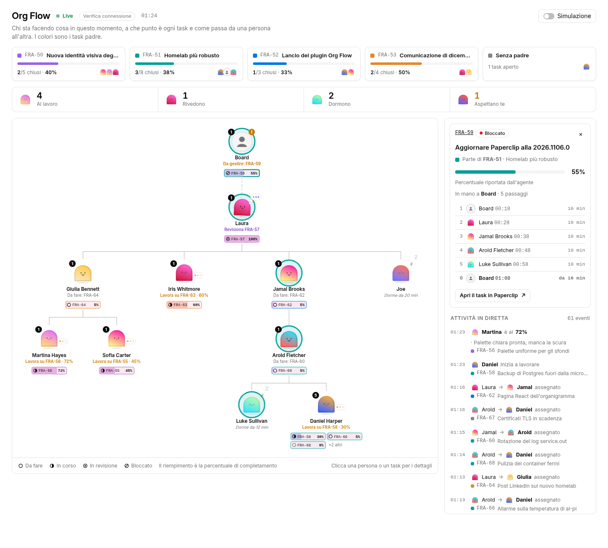
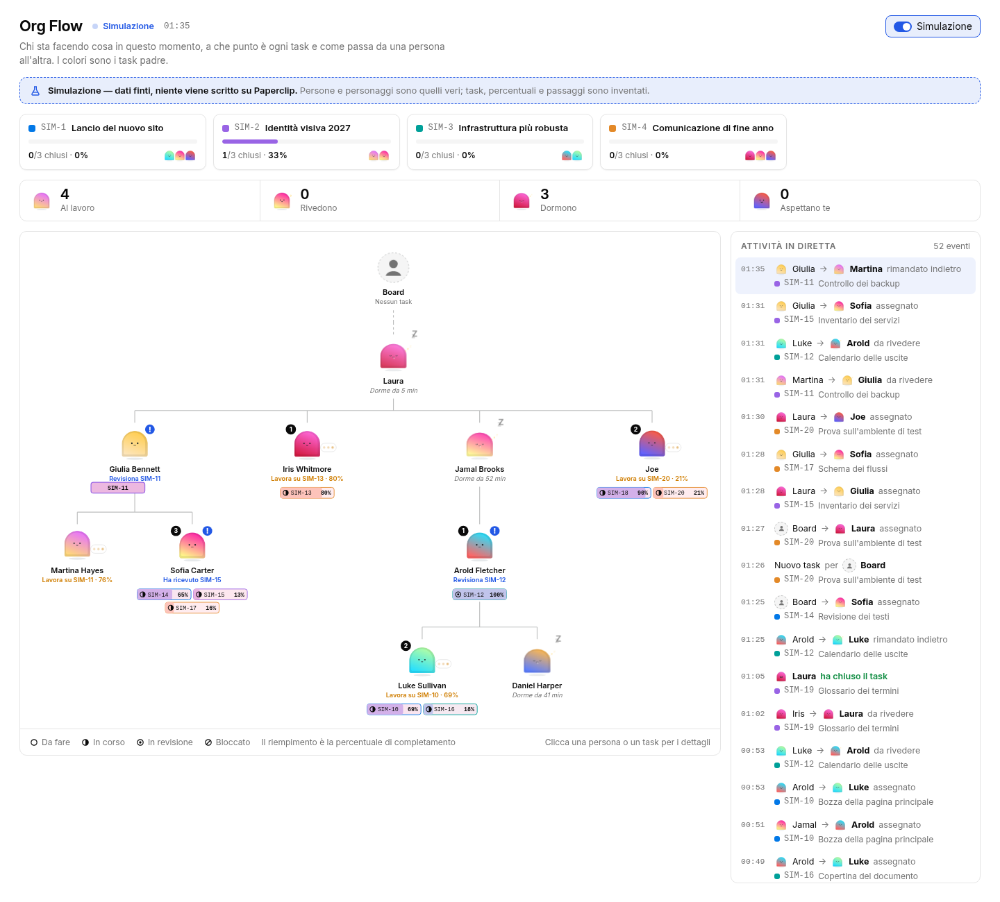

# Stati visivi e percentuali

Le regole esatte implementate oggi. I tempi sono costanti nel codice: il nome è indicato accanto, così il documento resta facile da aggiornare.

Ci sono due livelli:

1. **Stato calcolato dal worker** (`src/worker/presence.ts`), ricalcolato a ogni snapshot e almeno ogni 20 s.
2. **Effetti immediati della UI** (`src/ui/presence.ts`): quando arriva un evento la pagina cambia subito stato e posizione dei task, senza aspettare lo snapshot successivo.

## Stati delle persone (worker)

### Agenti

Le regole si valutano in quest'ordine; vince la prima che vale.

| # | Condizione | Stato | Posa | Etichetta |
| --- | --- | --- | --- | --- |
| 1 | `agentStatus = terminated` | `paused` | `rest` | "Non più attivo" |
| 2 | `agentStatus = paused` | `paused` | `rest` | "In pausa" |
| 3 | `agentStatus = error` | `confused` | `confused` | "In errore" |
| 4 | ultimo run fallito negli ultimi 10 min (`RUN_FAILED_WINDOW_MS`) | `confused` | `confused` | "Run fallito · FRA-62" (o "Run fallito") |
| 5 | un suo task è tornato indietro negli ultimi 2 min (`BOUNCE_WINDOW_MS`) | `confused` | `confused` | "Rimandato: FRA-62" |
| 6 | ha chiuso un task, o un suo task è stato approvato, negli ultimi 90 s (`CLOSED_WINDOW_MS`) | `success` | `success` | "Ha chiuso FRA-62" |
| 7 | ha ricevuto un task negli ultimi 60 s (`RECEIVED_WINDOW_MS`) | `listening` | `listening` | "Ha ricevuto FRA-62" |
| 8 | run in corso, oppure `agentStatus = running` | `working` | `working` | "Lavora su FRA-62 · 40%" (task del run, altrimenti il primo `in_progress`); "Lavora su FRA-62" se il task non è tra i suoi; "Al lavoro" se non c'è task |
| 9 | ha in mano un task `in_review` | `thinking` | `thinking` | "Revisiona FRA-62" |
| 10 | ha task aperti | `idle` | `idle` | un task: "In corso: FRA-62 · 40%", "Bloccato: FRA-62" o "Da fare: FRA-62"; più task: "3 task da fare" |
| 11 | nessuna attività nota, o nessuna attività da `sleepAfterMinutes` (predefinito 15) | `sleepy` | `sleepy` | "Dorme" |
| 12 | altrimenti | `idle` | `idle` | "Libero" |

Note:

- Un segnale con data nel futuro di più di 60 s viene ignorato (orologi sfasati).
- Al posto dell'identificatore si usa il titolo accorciato a 28 caratteri se il task non ne ha uno.
- Quando più task sono in mano, l'ordine per scegliere quello da mostrare è `in_progress`, `in_review`, `blocked`, `todo`, `backlog`, poi il più aggiornato.
- "Ultima attività" è la più recente tra: voci di cronologia che coinvolgono l'agente, eventi di run e di `progress` nel feed, inizio del run in corso, fine dell'ultimo run, `lastHeartbeatAt` di Paperclip.

#### Da dove vengono i segnali

| Segnale | Fonte |
| --- | --- |
| run in corso | evento `agent.run.started` senza fine; dopo un riavvio, il `activeRun` con stato `running` che Paperclip riporta sul task (vale solo se non è noto un run finito più recente). Un run senza fine da più di 6 ore è considerato perso (`STALE_RUN_MS`) |
| ultimo run | `agent.run.finished` / `agent.run.failed` seguiti dal worker, oppure gli stessi record nel feed salvato (vince il più recente). `agent.run.cancelled` chiude il run ma non conta come ultimo run |
| ricevuto | voce di cronologia `created` o `handoff` con l'agente come destinatario |
| chiuso | voce che porta lo stato a `done`. Riceve il segnale chi chiude (per un `handoff` verso `done` chi passava il task, altrimenti l'assegnatario); lo ricevono anche chi riceve il task chiuso e l'agente che ha fatto l'azione (es. il revisore che approva). Gli utenti umani non ricevono questo segnale extra |
| tornato indietro | vedi [Rimbalzi](#rimbalzi) |

Lo stato `running` dell'agente non arriva per evento (Paperclip non emette `agent.status_changed`): il worker lo imposta su `agent.run.started` e lo riporta a `idle` alla fine del run, senza toccare gli agenti in pausa o terminati.

### Utenti umani (board)

| Condizione | Stato | Etichetta |
| --- | --- | --- |
| ha task aperti assegnati | `waiting` | "Da gestire: FRA-59" oppure "3 task da gestire" |
| altrimenti | `idle` | "Nessun task" |

Gli utenti si chiamano "Board", "Board 2", … in ordine di id: il plugin non ha la capability per leggere i nomi dei membri.

## Effetti immediati nella pagina (UI)

Quando la pagina riceve un record nuovo (polling o simulazione) applica per qualche secondo uno stato "flash" alla persona, sposta il task e, per un passaggio, fa volare il chip. Il primo blocco di eventi caricato all'apertura della pagina non anima nulla.

| Record | Effetto |
| --- | --- |
| `handoff` verso un utente | chip in volo, poi l'utente passa a `waiting` "Ti aspetta FRA-59" |
| `handoff` con stato da `in_review` a `in_progress`/`todo`/`backlog` | chip in volo, poi chi riceve è `confused` "Rimandato indietro FRA-62" |
| `handoff` con `statusTo = in_review` | chip in volo, poi chi riceve è `listening` "Da rivedere: FRA-62" |
| altro `handoff` | chip in volo, poi chi riceve è `listening` "Ha ricevuto FRA-62" |
| `status` → `done` | l'assegnatario è `success` "Fatto! FRA-62"; se l'azione è di un altro agente, anche lui `success` "Ha approvato FRA-62"; il task va al 100% |
| `status` da `in_review` a `in_progress`/`todo`/`backlog` | l'assegnatario è `confused` "Rimandato indietro FRA-62" |
| `status` → `blocked` | `confused` "Bloccato su FRA-62" |
| `status` → `in_review` | `thinking` "Rivede FRA-62" |
| `created` | l'assegnatario è `listening` "Nuovo task: FRA-62" (`waiting` se è un utente) |
| `run_started` | l'agente è `working` "Lavora su FRA-62" o "Al lavoro" |
| `run_finished` | toglie il flash dell'agente |
| `run_failed` | `confused` "Run non riuscito" |
| `progress` | aggiorna solo la percentuale del task |

Tempi (`src/ui/presence.ts`):

| Costante | Valore | Uso |
| --- | --- | --- |
| `FLIGHT_MS` | 1,1 s | durata del volo; il flash di chi riceve parte all'atterraggio |
| `FLASH_MS` | 4,2 s | durata dei flash |
| `SUCCESS_FLASH_MS` | 5,2 s | flash di `success` |
| `WORKING_FLASH_MS` | 45 s | flash di `working` dopo `run_started` |
| `OVERRIDE_MAX_MS` | 45 s | un task spostato localmente torna ai dati del worker dopo questo tempo, o prima se arriva uno snapshot generato dopo l'evento |

Sugli utenti si applicano solo i flash `waiting`. Un flash nuovo sostituisce quelli precedenti della stessa persona. Con `prefers-reduced-motion` non ci sono voli né ritardi e le animazioni CSS sono ferme.

Il chip vola solo se mittente e destinatario sono entrambi nell'organigramma e sono persone diverse. Durante il volo il task non compare sotto nessuno dei due.

## Percentuale di un task

`resolveProgress` in `src/worker/progress.ts`. Ordine delle fonti; vince la prima disponibile:

| # | Fonte | `progressSource` | Regola |
| --- | --- | --- | --- |
| 1 | stato `done` | `status` | sempre 100 |
| 2 | valore riportato dall'agente | `reported` | ultimo `report_progress` sul task, arrotondato e limitato a 0–100; porta con sé la nota |
| 3 | sotto-task (solo se il task è un padre) | `children` | figli `done` / figli totali, annullati esclusi |
| 4 | checklist del documento `plan` | `checklist` | caselle spuntate / caselle totali |
| 5 | stima dallo stato | `status` | tabella sotto |

Arrotondamento: `Math.round`, poi limitato a 0–100.

### Valore riportato

Lo salva lo strumento `report_progress` ([agenti-e-percentuale.md](agenti-e-percentuale.md)). Viene azzerato quando:

- il task viene riaperto (da `done`/`cancelled` a uno stato aperto);
- il task passa a una persona diversa dall'agente che ha riportato il valore.

Resta valido se il task torna all'agente che l'ha riportato e quando cambia solo lo stato (es. `in_progress` → `in_review`: la percentuale riportata continua a valere al posto dell'85% stimato). I valori più vecchi di 30 giorni vengono scartati al salvataggio successivo.

### Checklist del piano

Si legge il documento con chiave `plan` del task (`ctx.issues.documents.get(id, "plan")`). Conta le righe che corrispondono a:

```
^\s*(?:[-*+]|\d+[.)])\s+\[([ xX])\]
```

Quindi valgono `- [ ]`, `* [x]`, `+ [X]`, `1. [x]`, `2) [ ]`, anche rientrate (liste annidate). Le righe dentro blocchi di codice (` ``` ` o `~~~`) non contano. Senza nessuna casella la checklist non c'è e si passa alla stima.

La checklist viene letta solo per i task aperti, che non sono padri e che non hanno un valore riportato. Resta in cache 10 minuti; un evento `issue.document.created/updated/deleted` sul documento `plan` la invalida subito.

Esempio: piano con

```markdown
## Passi
- [x] Inventario delle porte
- [x] Regole nftables
- [ ] Test da remoto
- [ ] Documentazione
```

→ 2 / 4 = **50%**, "dalla checklist del piano".

### Stima dallo stato

`STATUS_ESTIMATE` in `src/worker/progress.ts`:

| Stato | % |
| --- | --- |
| `backlog` | 0 |
| `todo` | 5 |
| `in_progress` | 40 |
| `in_review` | 85 |
| `blocked` | ultimo valore noto del task, altrimenti 40 |
| `done` | 100 |
| `cancelled` | 0 |
| stato sconosciuto | ultimo valore noto, altrimenti 0 |

"Ultimo valore noto" è l'ultima percentuale calcolata per il task quando non era bloccato né chiuso. È tenuta solo in memoria: dopo un riavvio del worker un task bloccato torna a 40.

## Percentuale di un task padre

Per il gruppo (`GroupView.progress`) e per il task padre stesso (fonte `children`):

- figli totali = tutti i figli del padre letti con `ctx.issues.getSubtree`, anche quelli chiusi da tempo e fuori dalla finestra visibile, esclusi gli annullati e i nascosti;
- figli chiusi = figli `done`;
- percentuale = chiusi / totali × 100; 0 se non ci sono figli;
- se il padre è `done`, il gruppo è al 100%.

Gli stati dei figli letti nello stesso giro (liste dei task) prevalgono su quelli in cache del sotto-albero. Un evento su un figlio aggiorna subito il conteggio del padre in cache.

Esempio: padre `FRA-51` con 9 figli: 3 `done`, 1 `cancelled`, 2 `in_progress`, 3 `todo` → 3 / 8 = **38%** ("3/8 chiusi · 38%" nella striscia dei padri).

Nota: un task padre con un valore riportato dall'agente mostra quel valore sul suo chip (fonte 2 prima della 3), mentre il gruppo usa sempre il conteggio dei figli.

### Gruppi e colori

- Un task con padre leggibile va nel gruppo del padre.
- Un task che è a sua volta padre (ha figli) e non ha un padre va nel proprio gruppo.
- Tutti gli altri vanno in `standalone` ("Senza padre" / "Task singoli"). Se il padre è stato cancellato o non è leggibile, i figli finiscono qui.
- Il raggruppamento è a un solo livello: un nipote va nel gruppo del suo padre diretto.
- Colore: hash FNV-1a dell'id del padre, 24 tinte distribuite con il rapporto aureo, `oklch(68% 0.15 <tinta>)` (64% per gialli e verdi, tinta 70–160). Stesso id, stesso colore, sempre. `standalone` è grigio `oklch(62% 0 0)`.

## Rimbalzi

`TaskView.bounces` conta le volte in cui il lavoro è tornato indietro (`backwardsTargets` e `isStatusRegression` in `src/worker/history.ts`). Un evento della cronologia conta se:

1. **rilavorazione dopo la revisione**: lo stato passa da `in_review` a `todo` o `in_progress`;
2. **riapertura**: lo stato passa da `done` a `todo`, `in_progress` o `in_review`;
3. **restituzione durante la revisione**: il task è `in_review` prima e dopo l'evento e viene passato **verso il basso** nella catena di riporto a qualcuno che l'aveva già avuto (il revisore lo restituisce senza cambiare stato).

"Verso il basso": chi passa è sopra chi riceve nella catena `reportsTo`; gli utenti del board sono sopra tutti gli agenti. Lo stato "prima" è quello dell'evento o, se l'evento non lo dice, l'ultimo stato noto dalla cronologia.

Chi riceve il segnale "tornato indietro" (stato `confused` per 2 minuti) è l'assegnatario per un cambio di stato, il destinatario per un passaggio.

Non contano: delegare verso il basso, restituire verso l'alto (per la revisione, per chiedere aiuto, quando è bloccato o finito), ripassare il task verso il basso dopo un'escalation (es. `blocked` → `todo`), il ritorno all'implementatore quando il revisore approva (`done`), gli spostamenti in `backlog` o `blocked` e gli annullamenti.

Esempi, con Laura responsabile di Giulia:

| Sequenza | Rimbalzi |
| --- | --- |
| Laura → Giulia (`todo`), Giulia → Laura (`in_review`), Laura → Giulia (`done`, approvato) | 0 |
| Laura → Giulia, Giulia → Laura (`in_review`), Laura → Giulia (`in_progress`) | 1 (rilavorazione) |
| Laura → Giulia, Giulia → Laura (`in_review`), Laura → Giulia (resta `in_review`) | 1 (restituzione durante la revisione) |
| Giulia → Laura (`blocked`), Laura → Giulia (`todo`) | 0 (ritorno dopo un'escalation) |
| `in_review` → `blocked` | 0 |
| task `done` riaperto in `todo` | 1 |

La scheda del task mostra "Rimandato N×" quando N > 0.

## Percorso (journey)

`holderSequences` e `journeyFor` in `src/worker/history.ts`:

- si parte dalla cronologia del plugin (voci `created` e `handoff`, dalla più vecchia);
- se la prima voce nota è un passaggio, il mittente diventa il primo passo;
- passi consecutivi della stessa persona si uniscono; i passaggi a "nessuno" si saltano;
- se la cronologia non sa nulla del task, il percorso è il solo assegnatario attuale (dalla creazione del task);
- se l'ultimo passo non è l'assegnatario attuale (passaggio perso), l'assegnatario attuale viene aggiunto con la data di aggiornamento del task.

La cronologia esiste dalla 1.0 e tiene le ultime 300 voci per company: i task più vecchi hanno un percorso parziale.

Nella scheda del task ogni passo mostra la persona, l'ora d'inizio e quanto è durato; l'ultimo, se il task è aperto, "da N min". Il numero di "passaggi" è il numero di passi meno uno.



## Statistiche per persona

Nella scheda di una persona (`PersonView.stats`), dalla cronologia delle ultime 24 ore:

- **ricevuti 24h**: voci `created`/`handoff` con la persona come destinatario;
- **passati 24h**: voci `handoff` con la persona come mittente;
- **chiusi 24h**: voci che portano lo stato a `done` con la persona come "chi chiude".

## Simulazione



La modalità simulazione (`src/ui/simulator.ts`) ha regole sue, più semplici: un tick al secondo vale un minuto simulato, un agente dorme dopo 5 minuti simulati senza task ("Dorme da N min"), etichette come "Smista FRA-64" e "Nessuna richiesta". Gli screenshot del banco di prova usano dati costruiti con queste etichette: in produzione le etichette sono quelle delle tabelle sopra.
