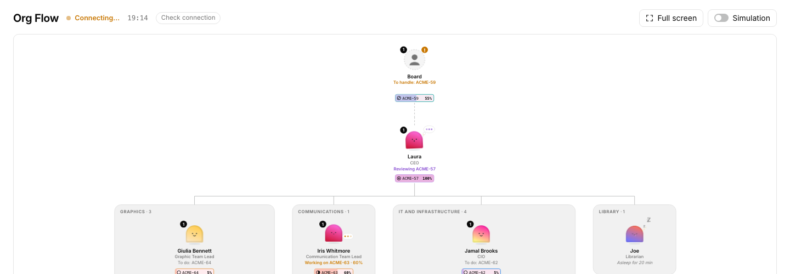

# Troubleshooting

Symptom → likely causes → what to do. The commands assume the variables from [installation.md](installation.md):

```bash
PC="paperclipai --api-base https://your-paperclip.example.com:"
```

and, for `curl`, `TOKEN`, `BASE`, `CO` as in [installation.md](installation.md#bridge-with-curl).

First check, almost always useful:

```bash
$PC plugin list                       # status, version, packagePath
$PC plugin logs franciuto.org-flow    # "org-flow: …" warnings
```

## The page says "Unreachable"

The indicator next to the title follows the `events` polling: "Live" (green) if requests succeed, "Connecting…" (yellow) before the first response or after an error, "Unreachable" (red) after 3 consecutive errors. The page keeps showing the last snapshot received.



| Cause | Check | Fix |
| --- | --- | --- |
| Plugin not `ready` (error, disabled, `upgrade_pending`) | `$PC plugin list` | see [Plugin in `error` state](#plugin-in-error-state) or approve the capabilities |
| Worker restarting (right after a build) | `$PC plugin logs franciuto.org-flow` | wait a few seconds: it goes back to "Live" by itself |
| Paperclip down or unreachable | `curl -sS -o /dev/null -w '%{http_code}\n' https://your-paperclip.example.com/api/health` | restart Paperclip; check the network and the reverse proxy |
| Browser session expired | the other Paperclip pages redirect to the login | log in again |
| Error in the worker on the `events` request | `curl` on `events` (below) answers 502 | read the message and the logs |

```bash
curl -sS -X POST "$BASE/bridge/data" -H "Authorization: Bearer $TOKEN" -H "Content-Type: application/json" \
  -d "{\"key\":\"events\",\"companyId\":\"$CO\",\"params\":{}}" | head -c 300; echo
```

With the browser tab in the background, polling stops; it resumes when you come back.

## "Cannot read the plugin data: …"

Shown when the page has never received a snapshot and the `snapshot` request fails. The text after the colon is the error from the host or the worker. The page retries by itself every 30 s.

- `Plugin is not ready (current status: …)`: the plugin is not `ready`, see below.
- Other messages: error in the worker while building. `$PC plugin logs franciuto.org-flow` and the `curl` on `snapshot`.

## Plugin in `error` state

| Cause | Clue | Fix |
| --- | --- | --- |
| `dist/` missing or incomplete (build failed or not done) | `lastError` mentions `dist/worker.js` or `dist/manifest.js` | `cd <your-clone> && npm ci && npm run build` |
| Missing dependencies after a `git pull` | import error | `npm ci && npm run build` |
| Invalid manifest | validation error | `npm test` (`tests/manifest.spec.ts` uses the host's validator) |
| Exception in the worker's `setup` | stack trace in the logs | fix, rebuild |
| Install path moved or deleted | `packagePath` in `$PC plugin inspect franciuto.org-flow` does not exist | reinstall from the right path ([installation.md](installation.md#first-installation)) |

After the fix: the build makes the plugin reload; if it stays in error, `$PC plugin enable franciuto.org-flow`. Paperclip retries plugins in error once anyway, at startup.

## The status is `upgrade_pending`

The new version declares capabilities that the registered one did not have. The worker stays stopped until the administrator approves them from the plugin's page in the instance settings. Alternatively: uninstall without `--force` and reinstall from your clone.

## No characters in the org chart

| Symptom | Cause | Fix |
| --- | --- | --- |
| "No agents in this company." | `agents.list` empty or failed on first load | log: `org-flow: agent list not available`; wait 60 s or reload the page (the `refresh` action re-reads the agents) |
| People are there but you see initials instead of characters | the agent has no `appearance.paletteId` | set the agent's appearance in Paperclip |
| Broken images | `/api/agent-avatars/cap-v1/<palette>/<pose>.png` does not respond (different Paperclip version, expired session) | open the image URL in the browser; if the host has changed the path, update `poseUrl` in `src/ui/format.ts` |
| An agent is missing | it is terminated and holds no tasks | normal: terminated agents appear only if they have tasks |
| An "Others" node appears (`···` icon) | there are open tasks assigned to someone who is not among the people in the org chart (e.g. a filtered agent or one no longer readable); the page gathers them there so as not to lose them (`bucketUnknownHolders` in `src/ui/model.ts`) | open the task from "Others" and check the assignee in Paperclip |
| An agent is at the top instead of under their manager | the manager (`reportsTo`) is not among the people shown, or there is a cycle in the chain | check `reportsTo` in Paperclip |

## Percentages are always "estimated from the status"

This is the expected behaviour with no other sources: the estimate uses only the status (`todo` 5, `in_progress` 40, `in_review` 85, …).

| Missing source | Why | What to do |
| --- | --- | --- |
| Reported value | agents do not use `report_progress`: nothing in their instructions tells them to | instance owner's decision, ready-made text in [agents-and-percentage.md](agents-and-percentage.md) |
| Checklist | the task has no document with key `plan`, or the plan has no `- [ ]` / `- [x]` checkboxes | ask the agents for a checklist in the plan |
| Checklist present but ignored | the task has a reported value (it wins), is a parent (the children win), is closed, or the document changed less than 10 minutes ago with no event | wait, or force it by reloading the page after 60 s |
| Sub-tasks | the task has no children | normal |

The source of each percentage is written in the task's detail panel ("Percentage …").

## Tasks are missing

| Case | Explanation |
| --- | --- |
| Task closed more than `keepClosedHours` hours ago (default 24) | no longer shown; increase the setting if needed |
| Task hidden in Paperclip (`hiddenAt`) | does not appear and does not count among the children |
| Task with no assignee | does not appear under any person (no chip), but counts in the groups |
| Person with more than 4 tasks | the visible chips are 3 plus "+N more"; the full list is in the person's detail panel |
| Task just created or moved | the chip arrives with the event (≤ 3 s); the complete data with the next snapshot. Task lists are re-read at most every 60 s, or sooner if an event arrives |
| Change made by a run with no activity event | the worker re-reads the lists on every run event; otherwise within 60 s |
| Filter active | a parent task selected in the strip at the top dims the other groups: click again to remove the filter |

Direct check:

```bash
curl -sS -X POST "$BASE/bridge/data" -H "Authorization: Bearer $TOKEN" -H "Content-Type: application/json" \
  -d "{\"key\":\"snapshot\",\"companyId\":\"$CO\",\"params\":{}}" \
  | python3 -c 'import json,sys; s=json.load(sys.stdin)["data"]; [print(t["identifier"], t["status"], t["holderId"], t["progress"], t["progressSource"]) for t in s["tasks"]]'
```

## Children end up in "No parent"

The parent is not readable (deleted, hidden or a temporary error). The worker retries after 30 s. If the parent exists, the debug-level logs contain `org-flow: parent task not readable`.

## A task's path is short or the "Sent back" is missing

The path comes from the plugin's history, which exists since 1.0 and keeps the last 300 entries. Handoffs from before the installation or older than that are not there. If the last handoff is missing, the worker still adds the current assignee.

## An agent stays "Working" or does not wake up

| Case | Explanation |
| --- | --- |
| Stays "Working" after the run ends | run-end event lost (worker restart during the run). The run Paperclip reports on the task counts until a more recent finished run arrives; after 6 hours it is ignored anyway |
| Does not go to "Asleep" | it has open tasks (whoever has tasks is "To do …", does not sleep), or it had activity in the last `sleepAfterMinutes` minutes |
| Stays in "Run failed" | it lasts 10 minutes from the last failed run |
| It is "In error" | `error` status in Paperclip: it is resolved from Paperclip (the status updates on `agent.updated`/`agent.error_cleared`) |

## The "Simulation" button is missing

`enableSimulation` is `false` in the settings. The simulation writes nothing to Paperclip; when it is on, the "Simulation — fake data" box appears and the indicator becomes "Simulation".

## The Dashboard widget says "Data not available right now."

Same cause as "Cannot read the plugin data": the `snapshot` request fails. The widget updates every 60 s.

## After a Paperclip update

1. `$PC plugin list`: if the plugin is `error`, read `lastError`. Typical causes: host API changed, manifest no longer valid for the new version.
2. Empty page or errors on the bridge: try `ping` ([installation.md](installation.md#bridge-with-curl)). If `ping` works and `snapshot` does not, the problem is in a host read (`issues.list`, `getSubtree`, `documents.get`): see the logs.
3. The stream: `curl` on `bridge/stream/org-flow`. If it is no longer 501 the UI switches to the stream by itself and polling slows to 30 s.
4. If the new SDK is incompatible: update `@paperclipai/plugin-sdk` in `package.json`, `npm install`, `npm run typecheck && npm test`, fix, release.
5. The saved state (feed, history, percentages) is in the database and survives. The plugin's code lives outside Paperclip's install folder.

## The running plugin changes after a development build

The plugin is installed from the folder where you develop: Paperclip reloads the plugin on every change to `dist/` in the installed folder. Check `packagePath` with `$PC plugin inspect franciuto.org-flow` and reinstall from a dedicated clone ([installation.md](installation.md#first-installation)).

## Log warnings

| Message | Meaning |
| --- | --- |
| `org-flow: state read failed, retrying later` | the database did not respond; feed and history stay in memory and are not saved until the read succeeds (new attempt after 10 s) |
| `org-flow: state save failed` | write failed; the data stays in memory |
| `org-flow: snapshot build failed, using previous data` | reading tasks or agents failed; health `degraded` for 5 minutes |
| `org-flow: agent list not available` | `agents.list` failed; the previous list stays |
| `org-flow: task read failed` | enrichment of an event failed; the event is published with the data it carries |
| `org-flow: stream send failed` | emitting on the stream gave an error; no visible effect, because the page uses polling |
| `org-flow: settings read failed, using defaults` | `config.get` failed |
